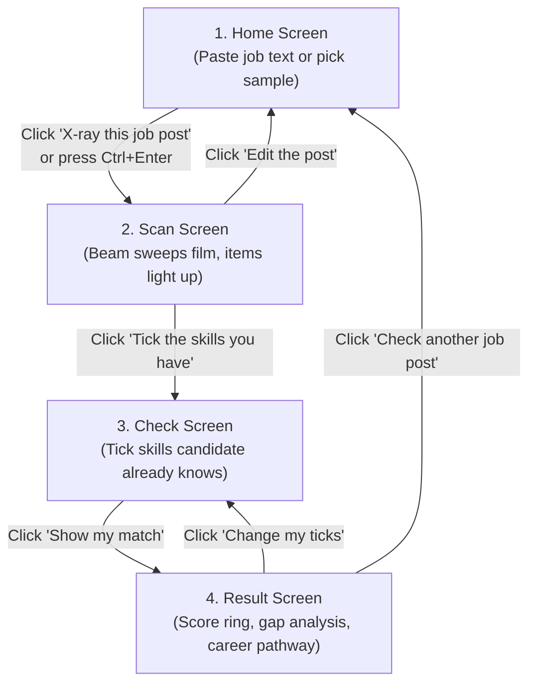
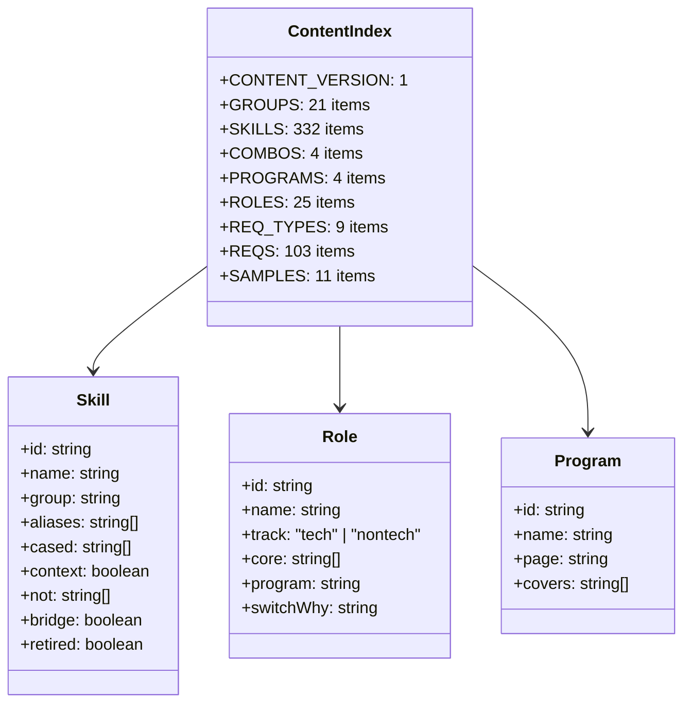
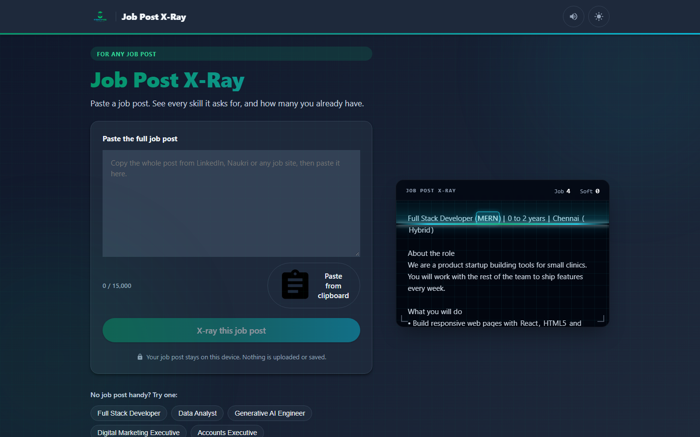
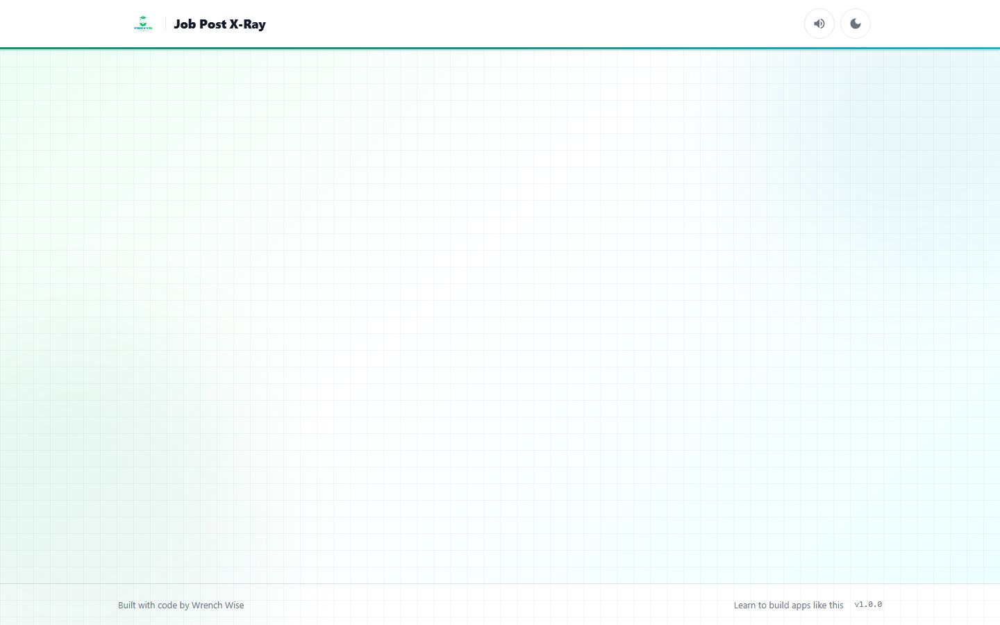
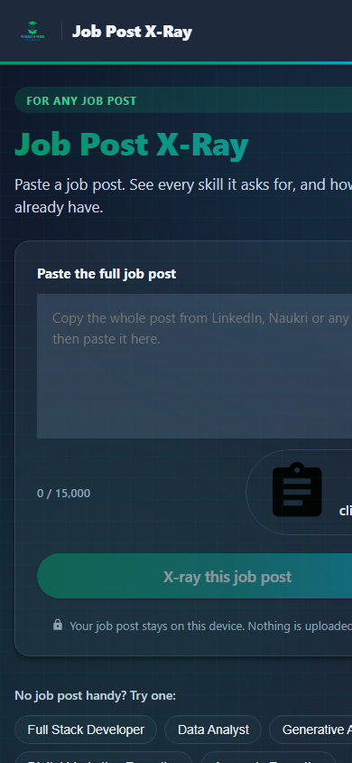
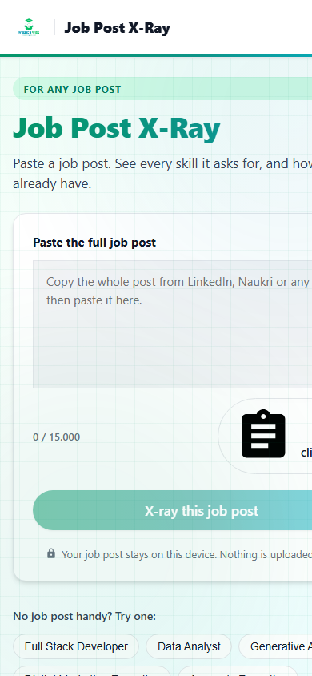
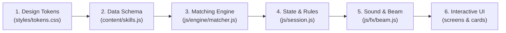

# Project Details: Find the Skills (Job Post X-Ray)

This document is the complete reference guide for the Job Post X-Ray project. It explains every detail of the project, including its purpose, screen flows, controls, algorithms, data files, code structure, styling, testing, deployment, and rebuild instructions.

---

## 1. Quick Summary

Job Post X-Ray is an in-browser scanner that reads job descriptions and identifies required technical skills, workplace competencies, and job constraints without sending text to any server. Job seekers tick the skills they currently have to receive an immediate match percentage, gap analysis, and recommended training pathways from Wrench Wise.

### Fact Table

| Project Property | Value in Project | Location in Codebase |
| :--- | :--- | :--- |
| Project Name | Job Post X-Ray (Find the Skills) | config.js, line 2; package.json, line 2 |
| Short Description | Paste any job post. See every skill it asks for, and how many you already have. | manifest.json, line 4; index.html, line 7 |
| Live Website Link | https://find-the-skills.vercel.app/ | config.js, line 10; README.md, line 3 |
| Git Repository URL | https://github.com/Pradeep-B28/Find_the_Skills.git | git remote -v |
| Active Git Branch | main | git branch --show-current |
| Current Version | 1.0.0 | config.js, line 6; content/index.js, line 12 |
| Last Update Date | 2026-11-02 (Commit 9f75482) | git log -1 --format="%ad" |
| Total Number of Files | 75 files (64 text files, 11 binary image files) | PowerShell file count |
| Total Lines of Text Code and Docs | 12,353 lines | Measure-Object sum |
| Lines of JavaScript (JS and MJS) | 7,937 lines (46 files) | js/, content/, tools/, config.js |
| Lines of CSS Stylesheets | 1,609 lines (4 files) | styles/tokens.css, base.css, xray.css, result.css |
| Lines of HTML Markup | 324 lines (3 files) | root index.html, job-post-xray/index.html, tools/og.html |
| Lines of Markdown and Documentation | 2,453 lines (8 files) | README.md, PROJECT_BRIEF.md, UPGRADE_GUIDE.md, etc. |
| Total Active Skills in Database | 332 skills (157 technical, 145 workplace, 30 soft) | content/skills.js, lines 33 to 739 |
| Skill Groups | 21 groups (10 tech, 10 work, 1 soft) | content/skills.js, lines 9 to 31 |
| Total Skill Aliases Checked | 1,901 aliases | tools/verify-content.mjs, line 20 |
| Bridge Skills (Transferable to Tech) | 37 skills | content/skills.js, bridge: true flags |
| Multi-Skill Combo Packages | 4 combos (MERN, MEAN, MEVN, C/C++) | content/combos.js, lines 5 to 10 |
| Defined Career Roles | 25 roles (13 tech, 12 non-tech) | content/roles.js, lines 7 to 123 |
| Requirements (Also Asks For) | 103 items across 9 structured categories | content/requirements.js, lines 6 to 184 |
| Requirement Aliases Checked | 364 aliases | tools/verify-content.mjs, line 22 |
| Built-in Sample Job Postings | 11 synthetic sample posts (s1 to s11) | content/samples.js, lines 7 to 274 |
| Automated Content Test Cases | 147 tricky sentences (100 skills, 47 requirements) | tools/cases.js, lines 6 to 184 |
| In-Browser Self-Test Assertions | 108 pass/fail unit assertions | js/selftest.js, lines 1 to 763 |
| Runtime External Dependencies | Zero (no npm packages, no CDNs, no web fonts) | package.json, lines 1 to 8 |

---

## 2. Purpose

### The Problem It Solves
Job postings are written as long, unorganized walls of text. Employers blend programming languages, frameworks, internal tools, soft skills, degree requirements, experience tenure, and operational conditions into unstructured paragraphs. This format creates three main problems for job applicants:
1. Intimidation: Fresh graduates and career switchers look at a 500-word job posting and feel unqualified because they do not recognize every single buzzword.
2. Skill Confusion: Candidates cannot easily tell which tools are strictly required, which ones are bonus qualifications, and which ones are non-skill constraints like shift timings or city locations.
3. Lack of Direction: When job seekers realize they are missing skills, typical job boards offer no clear educational path to bridge the gap.

### Who It Is For
1. Final-Year Students and Freshers: College students looking at their first software engineering or business analyst job postings to find out what the market requires.
2. Career Switchers: Non-technical professionals working in marketing, sales, accounting, human resources, graphic design, customer support, or mechanical engineering who want to find out how their existing domain skills transfer into technology.
3. Working Developers: Experienced engineers who want to assess their readiness for advanced disciplines such as Generative Artificial Intelligence, Machine Learning Engineering, or Cloud Architecture.
4. Social Media Viewers: People who watch educational screen recordings on Instagram, YouTube, or LinkedIn that show job descriptions being analyzed in real time.

### Why It Was Built
Job Post X-Ray was built as a high-intent, privacy-focused lead magnet for Wrench Wise educational programs (PROJECT_BRIEF.md, line 39). When someone copies and pastes a job posting, they are actively looking for a job. By diagnosing their exact skill deficit in under 10 seconds, the tool gives the user immediate clarity while introducing Wrench Wise as the training bridge.

The design emphasizes total privacy:
- The job post stays in device memory only.
- No text is uploaded to any backend database or third-party artificial intelligence service.
- Shared comparison links carry only skill identification codes in the URL query string, never the original job text.

### Connected Wrench Wise Programs
The tool connects directly to four certified training cohorts offered by Wrench Wise (content/programs.js, lines 5 to 48):
1. Certification Program in AI-Powered Software Engineering & DSA (program ID: sde):
   Covers 19 core skills including Java, Object-Oriented Programming (OOP), Data Structures and Algorithms (DSA), JavaScript, React, Node.js, Express.js, MongoDB, NoSQL, REST APIs, Authentication, Git, GitHub, JUnit, Software Testing, Postman, AI Coding Tools, Design Patterns, and System Design (content/programs.js, lines 10 to 13).
2. Certification Program in AI-Powered Full Stack Development (program ID: fsd):
   Covers 38 modern web development skills including HTML, CSS, Tailwind CSS, JavaScript, TypeScript, Responsive Design, React, Redux, Node.js, Express.js, MongoDB, NoSQL, REST APIs, Authentication, Postman, Jest, Software Testing, Git, GitHub, System Design, Design Patterns, Microservices, Python, Machine Learning, TensorFlow, OpenAI, LangChain, LangGraph, CrewAI, Recommendation Systems, CI/CD, GitHub Actions, AWS, Serverless, Docker, LangChain Chains, n8n Automation, and AI Coding Tools (content/programs.js, lines 19 to 24).
3. Certification Program in Artificial Intelligence & Machine Learning (program ID: aiml):
   Covers 44 data and intelligence skills including Python, NumPy, Pandas, Scikit-Learn, XGBoost, TensorFlow, PyTorch, Machine Learning, Deep Learning, Natural Language Processing (NLP), Computer Vision (CV), Feature Engineering, Statistics, Exploratory Data Analysis, Data Visualization, Matplotlib, Seaborn, Power BI, Jupyter Notebooks, ETL Pipelines, MySQL, SQL, Vector Databases, Embeddings, Large Language Models (LLM), Generative AI, Prompt Engineering, Retrieval-Augmented Generation (RAG), Transformers, Model Fine-Tuning, OpenAI, Hugging Face, LangChain, LangGraph, CrewAI, Agent Development Kits, Autonomous Agents, MLOps, Recommendation Systems, Streamlit, n8n, Git, GitHub, and Responsible AI (content/programs.js, lines 30 to 36).
4. Certification Program in Generative AI & Agentic AI (program ID: genai):
   Covers 24 advanced artificial intelligence skills including Python, Git, GitHub, Large Language Models (LLM), Generative AI, Prompt Engineering, Retrieval-Augmented Generation (RAG), Embeddings, Vector Databases, LangChain, LangGraph, CrewAI, Agent Development Kits, Model Context Protocol (MCP), Autonomous Agents, Neo4j Graph Databases, n8n, OpenAI, Google Gemini, Hugging Face, FastAPI, Streamlit, Docker, and LLMOps (content/programs.js, lines 42 to 46).

---

## 3. How to Open It

### Live Link
The application is deployed as a static web application and is publicly accessible at:
https://find-the-skills.vercel.app/

### How to Run It on a Laptop Step by Step
Running the application locally requires no build step, no compiler, and no package installations because all code uses native JavaScript ES modules (ECMAScript modules, the standard modular packaging system supported directly by modern web browsers).

1. Ensure Python or Node.js is installed on your computer:
   Open your operating system terminal (PowerShell or Command Prompt on Windows, Terminal on macOS or Linux) and run:
   `node --version` or `python --version`
2. Download or clone the project folder:
   If using git, run:
   `git clone https://github.com/Pradeep-B28/Find_the_Skills.git`
   `cd Find_the_Skills`
3. Navigate to the web application directory:
   If you are in the repository root, the main web files sit inside `job-post-xray`. Move into that directory:
   `cd job-post-xray`
4. Start a local static HTTP server:
   - Using Python 3:
     `python -m http.server 8085`
   - Alternatively, using Node.js without installing packages:
     `npx serve .`
5. Open your web browser:
   Visit the local address:
   `http://localhost:8085`
   The application will immediately render the home screen.

### Special URL Query Parameters
The application features several built-in URL query flags that alter its mode of operation. You can append these flags to the address bar:

| URL Parameter | Full Example Link | What It Does | Handled In |
| :--- | :--- | :--- | :--- |
| `?test=1` | `http://localhost:8085/?test=1` | Bypasses the user interface and runs the 108 automated in-browser unit tests. It renders a structured table showing every test group, pass or fail status, execution duration in milliseconds, and prints the same table to the browser developer console. | js/main.js, lines 153 to 158; js/selftest.js, lines 1 to 763 |
| `?demo=1` | `http://localhost:8085/?demo=1` | Launches hands-free automated demonstration mode designed for video screen recording. A visible translucent green circle (the tap dot) moves across the screen, types in a sample post, clicks X-Ray, watches the beam scan, ticks possessed skills, and scrolls to the score reveal. | js/main.js, lines 166 to 172; js/demo.js, lines 44 to 210 |
| `&sample=s1` to `s11` | `http://localhost:8085/?demo=1&sample=s5` | Combines with `?demo=1` to choose which of the 11 synthetic sample job posts to load for the demo run. For example, `sample=s1` runs Full Stack Developer, `sample=s5` runs Generative AI Engineer, and `sample=s7` runs Digital Marketing Executive. Defaults to `s1`. | js/demo.js, lines 47 to 56 |
| `&theme=dark` or `light` | `http://localhost:8085/?demo=1&sample=s5&theme=dark` | Forces the demo mode to run in dark theme or light theme, overriding system operating system preference. | js/demo.js, lines 48 to 54 |
| `&loop=0` | `http://localhost:8085/?demo=1&loop=0` | Instructs the automated demo runner to stop after completing a single demonstration cycle instead of repeating endlessly. | js/demo.js, lines 49 to 50 |
| `?present=1` | `http://localhost:8085/?present=1` | Activates high-contrast presenter mode for live webinars and classroom screenshares. Increases film body font size to 20px, hides sales WhatsApp buttons, shows an interactive chat prompt, and activates single-key keyboard shortcuts (keys 1 to 8, Enter, H, and T). | js/main.js, lines 161 to 164; js/presenter.js, lines 1 to 110 |
| `?s=...&r=...&m=...` | `http://localhost:8085/?s=py.sql.docker&r=fsd&m=2` | Opens comparison mode from a shared link. The parameter `s` carries dot-separated skill IDs, `r` carries the optional role ID, and `m` carries the friend's matched skill count. The home screen displays a comparison banner inviting the recipient to check their match against the sender. | js/main.js, lines 180 to 189; js/links.js, lines 22 to 66; js/screens/home.js, lines 72 to 105 |


---

## 4. Every Screen and Every Feature

Job Post X-Ray is structured as a single-page application (a web application that loads one HTML document and rewrites the page contents dynamically as the user navigates, without reloading the browser). It consists of a persistent application header and footer, and four distinct screen views (js/router.js, lines 5 to 15).



---

### Header and Global Shell
The application shell surrounds every screen with persistent branding and global utility controls (job-post-xray/index.html, lines 31 to 70).

1. Left Brand Header: Displays the Wrench Wise brand logo image (`assets/logo.png`) at 28px height, a thin vertical border line, and the bold text "Job Post X-Ray". If the logo image fails to load, it automatically falls back to clean text reading "Wrench Wise" (index.html, lines 33 to 38). Clicking the brand element resets the application and returns to the home screen.
2. Global Sound Toggle: A circular speaker button located at the top right. It toggles synthesized audio effects on and off. When unmuted, speaker sound waves display in SVG (Scalable Vector Graphics, an image format written in code that scales cleanly to any display size). When muted, a diagonal strike-through slash appears. The user selection is saved in browser storage under `jpx-muted` (js/main.js, lines 48 to 67; js/store.js, lines 53 to 59).
3. Theme Toggle Button: A circular button sitting next to the audio control. It toggles between the light theme and the dark theme. In light theme, an outline moon icon invites the user to switch to dark mode. In dark theme, a radiant sun icon invites switching back to light mode. The selection is saved in browser storage under `jpx-theme` (js/main.js, lines 12 to 46).
4. Top Brand Gradient Stripe: A 3px horizontal bar running directly under the header that showcases the Wrench Wise palette: emerald green (`#059669`), teal (`#0D9488`), and cyan (`#06B6D4`) (index.html, line 54; styles/base.css, lines 162 to 166).
5. Background Ambiance: The screen background displays a soft 24px grid pattern with 5 percent opacity and two blurred colored circles (one cyan, one emerald) that slowly drift in 25 to 28 second animation cycles (styles/base.css, lines 44 to 96).
6. Accessibility Live Region: An invisible screen reader container (`#live-region`) equipped with the ARIA (Accessible Rich Internet Applications, a standard for helping blind or visually impaired users navigate websites) `aria-live="polite"` attribute. When new scan counts or match scores calculate, this element updates so screen readers announce the findings out loud (index.html, line 59; js/screens/result.js, lines 91 to 95).
7. Application Footer: Displays the credit "Built with code by Wrench Wise", a hyperlink pointing to the official Wrench Wise learning portal with tracking parameters, and the version label "v1.0.0" (index.html, lines 61 to 69).

---

### Screen 1: Home Screen (js/screens/home.js)

The home screen provides the entry point where job seekers provide job descriptions for scanning.

#### What It Does
- Lets candidates paste raw job posts from job platforms like LinkedIn or Naukri.
- Provides 8 pre-loaded synthetic job posts to test the application instantly without copying text.
- Rejects web links and reminds users that raw text must be pasted instead.
- Shows an interactive 3D hero preview of the scanning film on laptops, and a flat preview on phones.
- Displays an informational accordion (an expandable panel that reveals hidden text when tapped) describing the lexical scanning engine.
- Displays a comparison banner if the page was accessed via a friend's comparison URL.

#### How to Use It (Click Steps)
1. Click inside the white text box labeled "Paste the full job post".
2. Paste any job posting text using keyboard shortcuts (Ctrl+V on Windows, Cmd+V on macOS) or right-click and choose Paste. If your browser supports clipboard access, click the "Paste from clipboard" button (js/screens/home.js, lines 152 to 168).
3. Observe the character counter at the bottom left of the box. As soon as the text reaches at least 40 characters, the primary button "X-ray this job post" activates and turns bright emerald green.
4. Alternatively, click any of the 8 sample chips located under the text box (for example, "Full Stack Developer", "Data Analyst", or "Digital Marketing Executive"). The text box automatically populates with that sample job post.
5. Click "X-ray this job post" or press Ctrl+Enter to launch the scanner.

#### What the Person Sees
- On Phone (390 x 844 viewport):
  The layout displays as a clean single column. The title, subtitle, paste box, character counter, and emerald primary button fit comfortably on screen without scrolling. Below the button, the 8 sample chips wrap into two rows, followed by the compact hero film preview, the three-step "How it works" guide, and the expandable "How the X-ray works" details drawer (styles/base.css, lines 205 to 290).
- On Laptop (1440 x 900 viewport):
  The screen splits into two balanced columns. The left column holds the text box, character counter, buttons, and sample chips. The right column showcases a larger 3D hero film tile. When the user moves their mouse over the right column, the hero card tilts in 3D space by up to 5 degrees following the pointer, settling back to level resting position (`rotateX(0deg) rotateY(0deg)`) when the pointer leaves (js/fx/hero.js, lines 177 to 225).

---

### Screen 2: Scan Screen (js/screens/scan.js)

The scan screen delivers the headline visual experience: an animated optical beam scanning down a dark film lightbox.

#### What It Does
- Renders the job text inside a dark digital film strip modeled after an authentic medical X-ray film on an illuminated lightbox.
- Moves an animated beam of light down the text at human scanning speed.
- Detects and highlights technical skills in glowing cyan, workplace skills in emerald green, and organizational requirements in amber dashed lines.
- Synthesizes real-time audio blips and humming frequencies using the browser Web Audio API without requiring any audio media files.
- Increments live counters for "Job skills" and "Soft skills" as each unique item is crossed.
- Displays a summary drawer at the conclusion of the scan reporting the findings and guessing the candidate's target job role.
- Handles edge cases where a job post contains zero skills or fewer than 3 skills.

#### How to Use It (Click Steps)
1. Watch the scanning beam glide down the text strip.
2. If you want to skip the animation and see all highlights immediately, click or tap anywhere on the dark film panel (js/screens/scan.js, lines 167 to 173).
3. Once the scan completes, a summary bar slides up from the bottom of the screen.
4. Read the summary message (e.g., "19 job skills and 3 soft skills found" and "Looks like a Full Stack Developer job").
5. Click the primary button "Tick the skills you have" to move to the checklist.
6. If the post was truncated or missed important text, click the text button "Edit the post" to return to the home screen with your original text intact in the text box.

#### What the Person Sees
- Film Panel: A dark container (`#050B16` in light theme, `#02060F` in dark theme) with a faint cyan grid and four white L-shaped corner brackets (styles/xray.css, lines 7 to 48).
- Header Strip: Displays the monospace title "JOB POST X-RAY" and two live counters: "Job skills" and "Soft skills" (styles/xray.css, lines 50 to 95).
- Key Indicator: Displays three colored dots showing what the highlights mean: solid cyan for Job skills, solid green for Soft skills, and dashed amber for Also asks for (styles/xray.css, lines 97 to 125).
- Reading Beam: A 3px glowing horizontal laser line with a 60px soft light trail above it that travels down the text. When posts exceed the viewport height, the beam travels to 45 percent of the film height and holds position while the text scrolls upward smoothly beneath it (js/fx/beam.js, lines 135 to 165).
- Low Skill States:
  - If zero skills are detected, the screen displays a warning card titled "No skills found" with buttons to edit the post or load a sample (js/screens/scan.js, lines 242 to 273).
  - If 1 or 2 skills are detected, it displays "Only 1 job skill found" or "Only 2 job skills found" with buttons to "Continue anyway" or "Edit the post" (js/screens/scan.js, lines 275 to 306).

---

### Screen 3: Check / Tick Screen (js/screens/check.js)

The checklist screen allows job seekers to review the detected skills and mark the ones they currently know.

#### What It Does
- Organizes detected technical and workplace skills under clear category headings (such as "Languages", "Front end", "Back end", "Databases", or "Marketing").
- Displays mention badges (e.g. `x2`) next to tools mentioned multiple times in the job posting.
- Offers an interactive role dropdown that lets candidates correct or change the automatically guessed job title.
- Isolates soft skills under their own heading with a plain English note explaining that they are scored separately from technical skills.
- Presents an "Also asks for" informational card detailing non-skill requirements (experience, education, location, work mode, and certifications).
- Lets users expand an accordion titled "Show in the post" to see the lit film strip and verify where each skill was requested.
- Provides a "Remember my ticks on this device" toggle switch that stores possessed skills in browser storage for future visits.
- Keeps a sticky bottom action bar displaying the count of ticked skills and the primary button "Show my match".

#### How to Use It (Click Steps)
1. Read through the skill pills under each group heading.
2. Click or tap any skill pill you already possess. The pill instantly changes from white to emerald green, displays a checkmark icon, and emits a short 6-millisecond click sound.
3. If you make a mistake, tap the pill again to deselect it.
4. If the guessed job role chip is incorrect, click "Change" to open the native select menu and pick the appropriate career title or select "Other role" (js/screens/check.js, lines 103 to 142).
5. If you want the browser to remember your selections for the next time you scan a job post, turn on the checkbox "Remember my ticks on this device".
6. Review the read-only items in the "Also asks for" section (e.g., "0 to 2 years", "Chennai", "Hybrid", "B.E. or B.Tech").
7. Click the primary button "Show my match" in the sticky bar at the bottom of the screen.

#### What the Person Sees
- On Phone (390 x 844 viewport):
  The items stack vertically in a mobile-optimized checklist. Skill pills provide generous touch targets measuring at least 44px in height to prevent mis-clicks. The sticky bottom bar floats over the bottom of the viewport with a blurred background backdrop, ensuring the primary button is always reachable without obscuring the last skill pill (styles/result.css, lines 9 to 16; styles/base.css, lines 430 to 470).
- On Laptop (1440 x 900 viewport):
  The screen splits into two columns. The wide left column holds all the interactive skill pills grouped by category. The right column holds a sticky summary sidebar displaying the role selector chip, the "Remember my ticks" toggle, and the complete "Also asks for" card (styles/result.css, lines 112 to 140).

---

### Screen 4: Result Screen (js/screens/result.js)

The result screen reveals the final match score, analyzes qualification deficits, and suggests educational solutions.

#### What It Does
- Renders an SVG progress ring that animates from 0 percent to the candidate's exact match score over 900 milliseconds.
- Displays an animated tier classification stamp (e.g. "Fresh start", "Building up", "Good start", "Strong match", or "Ready to apply") that lands next to the ring rotated at negative 6 degrees.
- Outputs an encouraging headline sentence (e.g. "You match 7 of 19 job skills" or "You match 0 of 19 job skills. Every one of them can be learned").
- Displays a horizontal progress bar showing soft skill alignment.
- Sorts skills into clear pill lists: "You have (7)" in emerald green and "To learn (12)" in soft red.
- Renders customized modular cards based on the post classification:
  - Tech Post with Gaps: Renders the "Close the gap" card recommending the specific Wrench Wise training cohort that covers the largest portion of the missing skills.
  - Tech Post with No Matching Cohort: Suggests general Wrench Wise advisory.
  - Non-Tech Post: Renders the "Add tech to what you already know" card showing transferable bridge skills (such as Excel, SQL, or communication) and suggesting a transition pathway.
  - 100 Percent Match: Renders the "Ready to apply" card congratulating the applicant.
- Displays head-to-head comparison telemetry if the user entered via a friend's comparison link.
- Provides social sharing tools to generate custom graphical status cards (1080 x 1920 or 1080 x 1350) or copy private dot-notation links.
- Offers direct one-tap WhatsApp advisory opening a pre-filled chat with Wrench Wise counselors.

#### How to Use It (Click Steps)
1. Review your circular score ring and the tier stamp.
2. Read the breakdown under "You have" and "To learn" to see your exact skill inventory.
3. Review the recommended program card to see how many of your missing skills are taught in that cohort.
4. If you want counseling, click "Talk to us on WhatsApp". Your WhatsApp application opens with a pre-formatted message listing your target role, match score, and missing tools.
5. If you want to share your score with friends without sharing the job post text:
   - Select either the "Status" pill (vertical 9:16 format) or the "Post" pill (4:5 feed format).
   - Click "Share my match" to invoke your device native share sheet or download the generated PNG picture.
   - Alternatively, click "Copy link" to copy the private compare URL to your clipboard.
6. To re-adjust your selected skills, click the secondary button "Change my ticks".
7. To analyze an entirely different job description, click the secondary button "Check another job post".

#### What the Person Sees
- On Phone (390 x 844 viewport):
  The top hero area displays the 168px circular progress dial and the tilted tier stamp. Directly underneath, the headline match line, soft skill progress bar, and categorized chip lists stack cleanly. Below the chips sit the program recommendation card, the "Also asks for" card, the session invite card, the share card, and the bottom action buttons (styles/result.css, lines 175 to 260).
- On Laptop (1440 x 900 viewport):
  The page splits into a two-column desktop dashboard. The left column showcases a larger 200px progress dial, the tier stamp, the match sentences, and the full "You have" and "To learn" pill lists. The right column showcases the primary Wrench Wise recommendation card, the collapsible "Other Wrench Wise programs" drawer, the share generator card, and the navigation buttons (styles/result.css, lines 178 to 215).


---

## 5. Every Control

The table below catalogs every button, input, toggle switch, dropdown menu, and keyboard shortcut across the entire application:

| Control Label / Icon | Control Type | What It Does | Where It Sits on Screen | Code Location |
| :--- | :--- | :--- | :--- | :--- |
| Brand Logo / "Job Post X-Ray" | Link button (`<a>`) | Resets active scanning session and navigates back to the home screen | Top header, left side | index.html, lines 33 to 38; js/main.js, line 111 |
| Speaker Icon (`#btn-sound`) | Toggle button (`<button>`) | Mutes or unmutes Web Audio sound blips and hums; persists state to browser storage under `jpx-muted` | Top header, right side | index.html, lines 41 to 45; js/main.js, lines 133 to 139; js/store.js, lines 53 to 59 |
| Theme Icon (`#btn-theme`) | Toggle button (`<button>`) | Toggles visual presentation between light theme and dark theme; persists state to browser storage under `jpx-theme` | Top header, right side | index.html, lines 47 to 51; js/main.js, lines 123 to 130; js/store.js, lines 41 to 50 |
| "Check my match" | Primary button (`<button>`) | Reads passed compare parameters, initializes session from link, and opens the checklist screen | Home screen, inside the comparison banner above the paste box | js/screens/home.js, lines 88 to 102; js/session.js, lines 74 to 100 |
| "Paste the full job post" | Text area (`<textarea>`) | Captures raw pasted job posting text up to 15,000 characters; updates character count live on every keystroke | Home screen, center paste card | js/screens/home.js, lines 117 to 123; config.js, line 44 |
| "Paste from clipboard" | Secondary button (`<button>`) | Reads clipboard text directly using the browser Clipboard API and inserts it into the text box; shows fallback instructions if permission is denied | Home screen, toolbar under text area on the right | js/screens/home.js, lines 152 to 168; js/copy.js, lines 14 to 15 |
| "Clear" | Text button (`<button>`) | Clears all text from the text box and resets the character counter back to 0 | Home screen, toolbar under text area on the right (visible only when box has text) | js/screens/home.js, lines 170 to 177 |
| "X-ray this job post" (`#btn-xray`) | Primary action button (`<button>`) | Validates input length (requires at least 40 characters), masks links, tokenizes skills, and navigates to the scan screen | Home screen, bottom of paste card (full width on mobile) | js/screens/home.js, lines 183 to 207; config.js, line 45 |
| Ctrl + Enter (Cmd + Enter on macOS) | Keyboard shortcut | Triggers the primary "X-ray this job post" scan action from inside the text area | Home screen, while text area has keyboard focus | js/screens/home.js, lines 242 to 247 |
| Sample Chips (e.g. "Full Stack Developer", "Data Analyst") | Filter pill buttons (`<button>`) | Inserts pre-written synthetic job post text into the text box and smoothly scrolls to the input box | Home screen, beneath paste card | js/screens/home.js, lines 260 to 287; content/samples.js |
| "How the X-ray works" | Accordion toggle (`<details>`) | Expands or collapses a short technical explainer about the 332-skill lexical scanner and privacy guarantees | Home screen, lower section | js/screens/home.js, lines 314 to 326; js/copy.js, lines 24 to 25 |
| "Save my seat" | External link button (`<a>`) | Opens registration page for upcoming live Wrench Wise masterclasses in a new browser tab (active only when `session.enabled` is true) | Home screen and Result screen, inside session card | js/cards/session.js, lines 41 to 47; config.js, lines 30 to 35 |
| Film Panel Tap | Click / Tap area | Skips ongoing beam animation and immediately finishes all light-up effects and text counters | Scan screen, entire dark film lightbox | js/screens/scan.js, lines 167 to 173; js/fx/beam.js, lines 237 to 244 |
| "Tick the skills you have" | Primary action button (`<button>`) | Advances from completed scan screen to the interactive skill checklist screen | Scan screen, bottom action drawer | js/screens/scan.js, lines 222 to 232 |
| "Edit the post" | Secondary text button (`<button>`) | Returns to home screen with previous text preserved so the candidate can add missing sections | Scan screen, bottom action drawer | js/screens/scan.js, lines 234 to 238 |
| "Continue anyway" | Secondary button (`<button>`) | Bypasses the "fewer than 3 skills" warning and forces navigation to the checklist | Scan screen, displayed only during low-skill warnings | js/screens/scan.js, lines 294 to 298 |
| "Try a sample" | Secondary button (`<button>`) | Loads sample s1 (Full Stack Developer) when a pasted post yields zero skills | Scan screen, displayed only during zero-skill warnings | js/screens/scan.js, lines 263 to 267 |
| Role Selector Dropdown | Native select menu (`<select>`) | Overrides the engine guessed role title; updates role tracking, career switch logic, and WhatsApp sales messages | Check screen, top role bar | js/screens/check.js, lines 103 to 142; js/session.js, lines 126 to 128 |
| Skill Chip Pills (Job and Soft skills) | Interactive toggle buttons (`<button aria-pressed>`) | Toggles candidate ownership of a skill; flips background color to emerald, shows checkmark, and plays click sound | Check screen, grouped by category | js/screens/check.js, lines 219 to 247; js/fx/sound.js, lines 145 to 167 |
| "Remember my ticks on this device" | Checkbox input (`<input type="checkbox">`) | Saves currently selected skill IDs into browser storage under `jpx-skills` (capped at 200 items); clears storage when unchecked | Check screen, below role bar | js/screens/check.js, lines 161 to 178; js/store.js, lines 61 to 87 |
| "Clear all" | Text button (`<button>`) | Unchecks all pre-filled remembered skill pills from the previous session | Check screen, inside the "Ticked from last time" banner | js/screens/check.js, lines 152 to 157; js/session.js, lines 130 to 135 |
| "Show in the post" | Accordion toggle (`<details>`) | Expands a stationary illuminated view of the X-ray film lightbox so candidates can review where tools appear in text | Check screen, lower section | js/screens/check.js, lines 341 to 359 |
| "Show my match" | Primary action button (`<button>`) | Calculates match score percentage, evaluates program coverage, and navigates to the result screen | Check screen, sticky bottom navigation bar | js/screens/check.js, lines 364 to 386; js/router.js, lines 24 to 50 |
| "Status" Size Pill | Tab button (`<button>`) | Selects 1080 x 1920 vertical format (9:16 aspect ratio) for WhatsApp status and Instagram story share graphics | Result screen, top of share card | js/cards/share.js, lines 33 to 48; js/shareImage.js, lines 19 to 20 |
| "Post" Size Pill | Tab button (`<button>`) | Selects 1080 x 1350 portrait format (4:5 aspect ratio) for LinkedIn and Instagram feed share graphics | Result screen, top of share card | js/cards/share.js, lines 38 to 53; js/shareImage.js, lines 19 to 20 |
| "Share my match" | Primary action button (`<button>`) | Renders HTML5 canvas graphic, triggers native operating system Web Share sheet, or downloads PNG image file | Result screen, inside share card | js/cards/share.js, lines 64 to 76; js/share.js, lines 21 to 74 |
| "Send on WhatsApp" | Secondary action button (`<button>`) | Formats text summary and compare link, opening WhatsApp with message pre-filled | Result screen, inside share card | js/cards/share.js, lines 79 to 90; js/share.js, lines 76 to 92 |
| "Copy link" | Secondary action button (`<button>`) | Copies private dot-notation comparison URL to clipboard; changes label to "Copied" for 2 seconds | Result screen, inside share card (hidden if skills exceed 60) | js/cards/share.js, lines 93 to 107; js/share.js, lines 94 to 142 |
| "Talk to us on WhatsApp" | Primary external link (`<a>`) | Opens direct WhatsApp chat with Wrench Wise counselors containing pre-formatted role, score, and missing skills | Result screen, inside program or switch card | js/cards/program.js, lines 87 to 93; js/cards/switch.js, lines 109 to 115; js/links.js, lines 85 to 133 |
| "See the program" | Text link (`<a>`) | Opens official Wrench Wise syllabus page in a new browser tab with UTM attribution parameters | Result screen, inside program or switch card | js/cards/program.js, lines 95 to 101; js/links.js, lines 148 to 157 |
| "Other Wrench Wise programs" | Accordion toggle (`<details>`) | Expands drawer listing other Wrench Wise courses that teach at least one of the candidate missing skills | Result screen, below primary recommendation card | js/cards/others.js, lines 21 to 77; config.js, line 64 |
| "Change my ticks" | Secondary button (`<button>`) | Returns to the checklist screen with all previously selected ticks preserved so the user can modify answers | Result screen, bottom action button group | js/screens/result.js, lines 242 to 248 |
| "Check another job post" | Secondary button (`<button>`) | Clears active post text, reset session memory, and returns to home screen | Result screen, bottom action button group | js/screens/result.js, lines 236 to 240; js/session.js, lines 137 to 148 |
| Keys 1 to 8 (Presenter Mode) | Keyboard shortcut | Automatically loads one of the 8 home sample posts in order and triggers the scanner | Active only when URL contains `?present=1` | js/presenter.js, lines 28 to 61 |
| Key Enter (Presenter Mode) | Keyboard shortcut | Clicks whichever primary button is currently active on screen to advance the presentation | Active only when URL contains `?present=1` | js/presenter.js, lines 64 to 82 |
| Key H (Presenter Mode) | Keyboard shortcut | Toggles visibility of all highlight spans on the film panel between transparent and visible | Active only when URL contains `?present=1` | js/presenter.js, lines 85 to 94 |
| Key T (Presenter Mode) | Keyboard shortcut | Automatically marks all `demoHave` skills for the currently active sample on the checklist screen | Active only when URL contains `?present=1` | js/presenter.js, lines 97 to 109; content/samples.js |

---

## 6. One Full Journey

To understand how user actions translate into program logic, this walk-through follows a real applicant analyzing synthetic sample `s1` (Full Stack Developer).

```mermaid
sequenceDiagram
    autonumber
    actor User
    participant Browser as Browser UI
    participant Session as js/session.js
    participant Matcher as js/engine/matcher.js
    participant Reqs as js/engine/requirements.js
    participant Gap as js/engine/gap.js
    participant Audio as js/fx/sound.js

    User->>Browser: Opens homepage and clicks "Full Stack Developer" chip
    Browser->>Browser: Populates text box with 1,027 characters of s1 text
    User->>Browser: Clicks "X-ray this job post"
    Browser->>Session: Calls startFromText(text)
    Session->>Matcher: Runs scan(text, skillIndex, 15000)
    Matcher-->>Session: Returns 22 unique skills (19 job, 3 soft) and 26 matches
    Session->>Reqs: Runs findRequirements(text, reqIndex, 15000)
    Reqs-->>Session: Returns 7 requirement items and 8 spans
    Session->>Gap: Runs guessRole(jobIds)
    Gap-->>Session: Matches 12 core skills -> Guesses "fsd" (Full Stack Developer)
    Browser->>Audio: Calls startBeamHum(2.0s)
    Browser->>Browser: Animates beam down film; lights up React, Node, Git, etc.
    Audio-->>Browser: Emits synthesized pitch blips as counters increment
    User->>Browser: Clicks "Tick the skills you have"
    Browser->>Browser: Renders check screen with 19 job skills and 3 soft skills
    User->>Browser: Taps HTML, CSS, JavaScript, Git, GitHub, SQL, OOP, Communication
    Browser->>Session: Calls toggle(id) for each clicked skill
    Audio-->>Browser: Plays 6ms click tone on each toggle
    User->>Browser: Clicks "Show my match"
    Browser->>Session: Calls report()
    Session->>Gap: matchReport: 7 of 19 job (37%), 1 of 3 soft (33%)
    Session->>Gap: pickProgram: FSD program covers 10 of 12 missing skills
    Browser->>Browser: SVG ring animates to 37%, tier stamp "Building up" lands
    Browser->>Browser: Program card shows 10 covered skills and WhatsApp link
```

### Step 1: Loading the Application and Selecting Sample s1
- What Happens on Screen:
  1. The user navigates to `https://find-the-skills.vercel.app/` or opens `http://localhost:8085/`.
  2. The home screen loads with the empty text box, character counter reading "0 / 15,000", and the primary button disabled (grayed out).
  3. The user clicks the sample chip titled "Full Stack Developer".
  4. The text area fills with 1,027 characters of job description text. The character counter immediately updates to read "1,027 / 15,000", and the emerald button "X-ray this job post" becomes active.
- What Happens in Code:
  1. `boot()` in `js/main.js` initializes the theme from `localStorage` or system preference (`initTheme`), initializes Web Audio listeners (`initSound`), reads URL query parameters, and mounts the home screen via `goToHome()` (js/main.js, lines 119 to 193).
  2. The sample chip click handler fetches object `s1` from `content/samples.js`. It assigns `s1.text` to `textarea.value` and fires an `input` DOM event (js/screens/home.js, lines 270 to 286).
  3. The `input` listener calculates string length, updates `countSpan.textContent` using `t("home.count")`, enables the submit button, and focuses the button element (js/screens/home.js, lines 212 to 238).

### Step 2: Triggering the Scan
- What Happens on Screen:
  1. The user clicks "X-ray this job post" or presses Ctrl+Enter.
  2. The screen immediately transitions to the dark film lightbox.
  3. The counters in the top right read "Job skills 0" and "Soft skills 0".
  4. The glowing cyan beam sweeps down the text. As it crosses each line, terms like "React", "Node.js", "Docker", and "B.Tech" light up with distinct color outlines.
  5. The job counter counts up from 0 to 19, the soft counter counts from 0 to 3, and synthesized sound blips chime in escalating musical pitches.
  6. When the beam completes its sweep, an action drawer slides up reading: "19 job skills and 3 soft skills found" and "Looks like a Full Stack Developer job".
- What Happens in Code:
  1. `home.js` invokes `onStartScan(text)`, calling `navigate("scan", { text })` in `js/router.js` (js/main.js, lines 73 to 76; js/router.js, lines 24 to 50).
  2. `scan.js` invokes `startFromText(text)` in `js/session.js`. This executes `scanPost(text)` in `js/content.js` (js/session.js, lines 44 to 72).
  3. Inside `scanPost()`:
     - `scan()` in `js/engine/matcher.js` masks web links and matches 22 unique skill IDs across 26 text spans: `mongodb`, `express`, `react`, `node`, `html`, `css`, `rest`, `github`, `git`, `js`, `dsa`, `oop`, `auth`, `sql`, `ts`, `nextjs`, `docker`, `aws`, `aitools`, `motivated`, `comm`, `team`.
     - Notice counts calculate repeats: `mongodb`, `express`, `react`, `node`, `js`, `auth`, and `aitools` each appear twice (`x2`) (js/engine/matcher.js, lines 132 to 142).
     - `findRequirements()` in `js/engine/requirements.js` parses experience tenure `0 to 2 years`, location `Chennai`, work mode `Hybrid`, degrees `B.E. or B.Tech`, `BCA`, `MCA`, and joining timeline `Immediate joiners` across 8 text spans (js/engine/requirements.js, lines 129 to 160).
     - `mergeSpans()` combines these into an ordered highlight list where technical skills take precedence over overlapping tokens (js/engine/requirements.js, lines 165 to 180).
     - `guessRole()` in `js/engine/gap.js` inspects the 19 job skills against the core lists in `content/roles.js`. Role `fsd` scores 12 core hits (`js`, `react`, `node`, `express`, `mongodb`, `html`, `css`, `rest`, `ts`, `nextjs`, `sql`, `git`), easily passing the minimum threshold of 3 hits and winning the role guess (js/engine/gap.js, lines 7 to 20).
  4. `renderFilm()` builds DOM nodes using safe `document.createTextNode` and `<mark>` elements (js/fx/film.js, lines 9 to 60).
  5. `runScan()` in `js/fx/beam.js` calculates animation duration (`1.6s + 0.25 * 1.027 = 1.85s`), starts the 110Hz sine wave hum in `js/fx/sound.js`, moves the beam using cubic-bezier easing (`0.4, 0, 0.2, 1`), checks mark offsets, calls `lightUp()`, and triggers `playJobBlip()` and `playSoftBlip()` as new IDs are passed (js/fx/beam.js, lines 85 to 225).

### Step 3: Ticking Possessed Skills
- What Happens on Screen:
  1. The user clicks "Tick the skills you have".
  2. The checklist screen loads. The top title states: "This job post asks for 19 job skills".
  3. The role chip displays: "Looks like a Full Stack Developer job".
  4. The candidate clicks 7 job skills they know: HTML, CSS, JavaScript, Git, GitHub, SQL, and OOP. Each pill turns green with a checkmark.
  5. The candidate scrolls to the soft skills section and clicks Communication.
  6. In the sticky bottom bar, the counter updates to read "8 ticked" next to the emerald button "Show my match".
- What Happens in Code:
  1. `scan.js` invokes `onNext()`, which routes to `check.js` (js/main.js, lines 90 to 92).
  2. `check.js` reads session state via `getState()`. It groups the 19 job skills under their respective categories using `groupedJob(jobIds)` in `js/content.js`: Languages (js), Front end (html, css, react, ts, nextjs), Back end (node, express, rest, auth), Databases (mongodb, sql), Cloud and DevOps (docker, aws), Tools and practices (github, git, dsa, oop, aitools) (js/content.js, lines 85 to 113).
  3. Mention badges (`x2`) are appended for skills where `counts[id] >= 2` (js/screens/check.js, lines 236 to 242).
  4. Each pill click invokes `toggle(id)` in `js/session.js`, adding or removing the ID from the internal `ticked` Set, and calls `playClick()` in `js/fx/sound.js` (js/session.js, lines 102 to 111; js/fx/sound.js, lines 145 to 167).
  5. `emit("check:toggle", { id, have })` broadcasts the change on the event bus (js/screens/check.js, line 230).

### Step 4: Revealing the Match and Bridge Recommendation
- What Happens on Screen:
  1. The candidate clicks "Show my match".
  2. The result screen renders. The SVG circular ring animates from 0 percent to 37 percent over 900 milliseconds. The center counter counts up from 0 to 7, displaying "7/19 job skills matched".
  3. The tier stamp "Building up" scales down from 1.4 to 1 and rotates negative 6 degrees next to the dial.
  4. Below the dial, the match line reads: "You match 7 of 19 job skills."
  5. The soft skill progress bar fills to 33 percent, reading: "Soft skills: 1 of 3."
  6. The chip lists categorize the candidate inventory:
     - "You have (7)": HTML, CSS, JavaScript, Git, GitHub, SQL, OOP.
     - "To learn (12)": MongoDB, Express.js, React, Node.js, REST APIs, Data structures and algorithms, Authentication, TypeScript, Next.js, Docker, AWS, AI coding tools.
     - "Soft skills you have (1)": Communication.
     - "Soft skills to build (2)": Self motivated, Team player.
  7. The primary recommendation card titled "Close the gap" announces:
     "The Certification Program in AI-Powered Full Stack Development covers 10 of the 12 skills you're missing."
  8. A chip flow showcases the 10 missing tools taught by the program: MongoDB, Express.js, React, Node.js, REST APIs, Authentication, TypeScript, Docker, AWS, AI coding tools.
  9. A quiet footnote clarifies: "Not in this program: Data structures and algorithms and Next.js."
  10. The applicant clicks "Talk to us on WhatsApp". WhatsApp launches with a pre-filled message:
      "Hi, I checked a Full Stack Developer job post on Job Post X-Ray. I match 7 of 19 job skills. I'm missing MongoDB, Express.js, React, Node.js and 8 more. I'd like to know more about the Certification Program in AI-Powered Full Stack Development."
- What Happens in Code:
  1. `check.js` invokes `onShowMatch()`, routing to `result.js` (js/main.js, lines 101 to 103).
  2. `result.js` calls `report()` in `js/session.js`. Inside `report()`:
     - `matchReport(jobIds, ticked)` calculates: `total = 19`, `have = 7`, `missing = 12`, `pct = Math.round(7 / 19 * 100) = 37%` (js/engine/gap.js, lines 23 to 29).
     - `matchReport(softIds, ticked)` calculates: `total = 3`, `have = 1`, `missing = 2`, `pct = 33%`.
     - `mainScore()` returns `{ kind: "job", have: 7, total: 19, pct: 37 }` (js/engine/gap.js, lines 86 to 89).
     - `postKind()` determines track is `"tech"` because role `fsd` has `track: "tech"` (js/engine/gap.js, lines 76 to 83).
     - `rankPrograms()` compares the 12 missing skills against the `covers` lists of all 4 programs in `config.programs` (`sde`, `fsd`, `aiml`, `genai`):
       - `fsd` covers 10 missing skills (`mongodb`, `express`, `react`, `node`, `rest`, `auth`, `ts`, `docker`, `aws`, `aitools`).
       - `sde` covers 8 missing skills (`mongodb`, `express`, `react`, `node`, `rest`, `auth`, `aitools`, `dsa`).
       - `genai` covers 1 missing skill (`docker`).
       - `aiml` covers 0 missing skills.
       `fsd` ranks first with 10 covered skills (js/engine/gap.js, lines 37 to 57).
     - `pickProgram()` selects `fsd` as the top recommended program (js/engine/gap.js, lines 61 to 65).
  3. `renderRing()` sets `strokeDashoffset` dynamically via `requestAnimationFrame` and invokes `countUp()` to count the numerical display smoothly (js/fx/ring.js, lines 62 to 118; js/fx/countup.js, lines 5 to 38).
  4. `renderStamp()` assigns the "Building up" tier string (tier logic: 25% to 49% = "Building up") and applies the CSS rotation transform (js/fx/stamp.js, lines 5 to 24; js/score.js, lines 8 to 15).
  5. `cards/program.js` renders the recommendation card, formats the missing list using `list()`, and builds the WhatsApp link via `salesUrl()` in `js/links.js` (js/cards/program.js, lines 11 to 150; js/links.js, lines 85 to 133).
  6. `emit("result:shown", ...)` broadcasts event telemetry to analytics listeners (js/screens/result.js, lines 250 to 264; js/analytics.js, lines 97 to 135).


---

## 7. The Logic

The core logic of Job Post X-Ray is divided into three pure algorithm modules that contain zero DOM (Document Object Model, the browser tree structure of HTML elements) code:
- `js/engine/matcher.js`: Lexical tokenization and skill pattern disambiguation.
- `js/engine/requirements.js`: Regex extraction of experience ranges, notice periods, and institutional criteria.
- `js/engine/gap.js`: Score calculation, role guessing, career switch analysis, and curriculum ranking.

Below is the detailed specification for every algorithm, rule, and formula in the project.

---

### 1. Web Link and Email Masking
- What It Does in Plain Words:
  Job posts frequently contain web links and email addresses (for example, `careers@reactlabs.co` or `github.com/profile`). Naive text searching would accidentally detect skills like "React" inside the email domain or "Git" inside the website link. This algorithm replaces all characters in URLs, emails, and web domain strings with empty space characters (` `) of the exact same length. This blinds the keyword scanner to link text while preserving the exact character index positions of the rest of the text.
- Worked Example from App:
  Input sentence from `tools/cases.js` (line 53):
  `"Send your GitHub profile link to careers@reactlabs.co"`
  The link masker identifies `careers@reactlabs.co` and replaces it with 21 empty spaces. The scanner searches the remaining text, correctly finding skill `github` from `"GitHub profile"`, while completely ignoring `react` inside `reactlabs.co`.
- Why This Method Was Chosen:
  Masking with spaces preserves identical string character offsets (`start` and `end`), so visual highlight positions line up perfectly with the original user text without complex coordinate translation.
- Speed (Big-O Complexity):
  $O(N)$ where $N$ is the character length of the job description (up to 15,000 characters). In plain words, it scans the text once from start to finish in linear time, taking less than 1 millisecond.
- Code Location:
  js/engine/matcher.js, lines 23 to 37 (`maskLinks`).

---

### 2. Whole-Word Boundary and Punctuation Edge Enforcement
- What It Does in Plain Words:
  Prevents short skill names from matching inside unrelated words. For example, the language `c` must not match inside "cat" or "policy", and `go` must not match inside "good" or "Django". It checks the character directly before the match start and directly after the match end. It confirms that the bordering characters are not letters, digits, underscores, plus signs (`+`), hash marks (`#`), or ampersands (`&`).
- Worked Example from App:
  Input sentence from `tools/cases.js` (line 29):
  `"Grade C or above in all subjects"`
  While the letter "C" is present, the engine checks its surrounding context. Because "Grade C" is not accompanied by any programming context and is an isolated academic grade, it is rejected. Conversely, in `"Proficiency in C, C++ or Java"`, the letter "C" is followed by a comma, not another letter or a plus sign (the `++` belongs to `cpp`), so `c` matches cleanly (tools/cases.js, line 22).
- Why This Method Was Chosen:
  Standard regular expression `\b` word boundaries fail on symbols like `C++`, `C#`, and `.NET` because regex engines consider punctuation characters to be boundary breaks. Custom boundary inspection handles technical symbols accurately.
- Speed (Big-O Complexity):
  $O(1)$ constant time lookup per match candidate. It checks only the immediate adjacent characters (indices $s-1$, $s-2$, $e$, and $e+1$).
- Code Location:
  js/engine/matcher.js, lines 39 to 48 (`edgesOk`).

---

### 3. Space and Hyphen Invariant Pattern Construction
- What It Does in Plain Words:
  Job descriptions write compound technical terms inconsistently. One employer writes "Fine Tuning", another writes "fine-tuning", and a third writes "fine tuning". This algorithm splits any alias on spaces or hyphens and joins the pieces with the regular expression pattern `[\s\-]+`.
- Worked Example from App:
  The alias `"fine tuning"` in `content/skills.js` (line 291) is compiled into the regular expression `fine[\s\-]+tuning`. In `tools/cases.js` (line 19), the sentence `"Spring-Boot, Node JS and Fine-Tuning"` matches `finetune` even though the user text uses a hyphen and capital letters.
- Why This Method Was Chosen:
  Eliminates the need to maintain duplicate alias entries for every possible permutation of spaces and hyphens.
- Speed (Big-O Complexity):
  $O(K)$ where $K$ is the character length of the alias string (typically 3 to 20 characters), executed once at startup during index construction.
- Code Location:
  js/engine/matcher.js, lines 30 to 32 (`aliasPattern`).

---

### 4. False-Positive Negation Filtering
- What It Does in Plain Words:
  Certain common English idioms share spelling with programming languages and tools. For example, "go-getter" contains "go", and "rest of the team" contains "rest". Each skill can define a list of `not` phrases. If a candidate match overlaps with any prohibited phrase, it is instantly discarded.
- Worked Example from App:
  In `content/skills.js` (line 51), skill `go` defines `not: ["go getter", "go above", "go beyond", "go to", "go live", "go through", "go ahead", "go along"]`.
  When scanning the sentence `"A go-getter attitude with Python"` (tools/cases.js, line 25), the word "go" overlaps with the blocked phrase "go-getter". The algorithm cancels the "go" match, leaving only `motivated` (from "go-getter") and `py` (from "Python").
- Why This Method Was Chosen:
  Provides a surgical, deterministic filter for common idioms without needing probabilistic machine learning.
- Speed (Big-O Complexity):
  $O(M \times B)$ where $M$ is the number of candidate matches and $B$ is the number of active blocked spans. Because $B$ is typically under 10, execution completes in microseconds.
- Code Location:
  js/engine/matcher.js, lines 107 to 119 (`scan`).

---

### 5. Longest-Match Prioritization
- What It Does in Plain Words:
  When multiple skills could match overlapping characters in the same sentence, the most specific, longest skill name must always win. If a candidate writes "React Native", a naive search would match both "React Native" and "React". The longest match rule ensures that "React Native" is assigned to the text, preventing the mobile framework from being misclassified as the web library.
- Worked Example from App:
  Input sentence from `tools/cases.js` (line 11):
  `"React Native and React"`
  The phrase contains two mentions. In the first mention, "React Native" (12 characters) competes with "React" (5 characters). The engine sorts all candidate spans by character length in descending order. "React Native" is processed first and claims characters 0 to 12. When "React" is evaluated for characters 0 to 5, the engine detects that characters 0 to 5 overlap an already accepted span, so that substring match is discarded. The second mention of "React" at character 17 has no overlap and matches successfully. The final output is `["rn", "react"]`.
- Why This Method Was Chosen:
  Guarantees that compound phrases always override their constituent sub-tokens.
- Speed (Big-O Complexity):
  $O(C \log C)$ where $C$ is the number of candidate spans, using JavaScript native Timsort algorithm.
- Code Location:
  js/engine/matcher.js, lines 122 to 126 (`scan`).

---

### 6. Sliding Context Window Disambiguation
- What It Does in Plain Words:
  Certain words in the English language are severely ambiguous. For example, "Go" is an everyday verb, "R" is a single letter, "Spring" is a season, "Express" is an adjective, and "Tally" means to count. Skills marked with `context: true` only count as a valid match if another legitimate, non-context skill is detected within a distance of 60 characters before or after the word.
- Worked Example from App:
  Input sentence A (tools/cases.js, line 24):
  `"Experience with Go and Kubernetes"`
  "Kubernetes" is an anchor skill located 8 characters away from "Go" (well within the 60-character threshold). Result: `go` and `k8s` both match.
  Input sentence B (tools/cases.js, line 32):
  `"Spring 2027 graduates can apply"`
  There are zero technical anchor skills within 60 characters of "Spring". Result: Discarded as an academic season reference (`[]`).
- Why This Method Was Chosen:
  Reduces false positive rates for monosyllabic and common dictionary terms to zero while maintaining offline client-side speed.
- Speed (Big-O Complexity):
  $O(K \times A)$ where $K$ is the number of context-dependent candidates and $A$ is the number of verified anchor skills. Because both numbers are small (typically under 20), this comparison takes less than 0.1 milliseconds.
- Code Location:
  js/engine/matcher.js, lines 19 and 128 to 130 (`scan`).

---

### 7. Multi-Skill Combo Acronym Expansion
- What It Does in Plain Words:
  Job postings frequently use industry acronyms to describe entire software stacks. For example, "MERN stack" implies four distinct competencies: MongoDB, Express.js, React, and Node.js. When the engine encounters a combo acronym, it registers all constituent skill IDs under that single text span.
- Worked Example from App:
  Input sentence from `tools/cases.js` (line 43):
  `"MERN stack developer"`
  The phrase matches the combo rule in `content/combos.js` (line 6). The engine expands the match into `["mongodb", "express", "react", "node"]`. All 4 skills are registered in the candidate inventory, while the visual film panel highlights the single phrase "MERN stack" in glowing cyan.
- Why This Method Was Chosen:
  Prevents candidates from being penalized when employers use compact industry shorthand instead of spelling out each database and framework individually.
- Speed (Big-O Complexity):
  $O(1)$ expansion per matched combo token.
- Code Location:
  js/engine/matcher.js, lines 78 to 83 (`buildIndex`) and 135 to 142 (`scan`).

---

### 8. Numeric Experience Range and Unit Parser
- What It Does in Plain Words:
  Recruiters specify experience tenure in diverse formats: "0 to 2 years", "3-5 yrs", "5+ years", "minimum 3 years", or "at least two years". The requirements engine uses four specialized regular expressions with numeric capture groups to extract the minimum tenure, maximum tenure, plus flags, and time units (years versus months). It automatically discards corporate age statements (e.g. "founded 15 years ago") and warranty terms.
- Worked Example from App:
  In sample `s1` (content/samples.js, line 12):
  `"Full Stack Developer (MERN) | 0 to 2 years | Chennai"`
  The parser matches pattern `EXP_PATTERNS[0]` (`range`), captures minimum `0`, maximum `2`, and unit `years`. It standardizes this into the requirement key `exp:0-2y`. In `js/score.js` (line 102), this key formats cleanly for the user as `"0 to 2 years"`.
  Conversely, in `tools/cases.js` (line 120), `"Company with 25 years of excellence"` is caught by the `AFTER_BAD` filter (`of excellence`), and is rejected.
- Why This Method Was Chosen:
  Captures real-world numeric employment requirements without being tricked by company marketing copy or candidate age limits.
- Speed (Big-O Complexity):
  $O(N)$ linear regex sweep across the job description string.
- Code Location:
  js/engine/requirements.js, lines 27 to 40 and 78 to 110 (`experienceCandidates`).

---

### 9. Notice Period and Joining Parser
- What It Does in Plain Words:
  Identifies mandatory candidate availability constraints written as days or months (e.g. "notice period: 30 days" or "immediate joiners"). It caps valid notice values at 180 days or 6 months to prevent capturing unrelated numbers.
- Worked Example from App:
  In sample `s2` (content/samples.js, line 60):
  `"Notice period: up to 30 days."`
  The parser matches `NOTICE_PATTERNS[0]`, extracts amount `30` and unit `days`, generating requirement key `notice:30d`. In the user interface, this renders as `"Notice period up to 30 days"` (content/samples.js, line 720).
- Why This Method Was Chosen:
  Allows job seekers to immediately spot restrictive joining requirements before applying.
- Speed (Big-O Complexity):
  $O(N)$ linear regex search.
- Code Location:
  js/engine/requirements.js, lines 42 to 45 and 112 to 123 (`noticeCandidates`).

---

### 10. Film Highlight Span Merging
- What It Does in Plain Words:
  Combines technical skills, workplace soft skills, and organizational requirements into a single non-overlapping array of visual spans to render on the X-ray film lightbox. If a requirement accidentally overlaps with a skill, the skill always takes precedence on the film.
- Worked Example from App:
  In sample `s1`, the scanner identifies 26 skill spans and 8 requirement spans. `mergeSpans()` combines these into 34 ordered visual highlights: 23 job skill highlights (cyan), 3 soft skill highlights (green), and 8 requirement highlights (amber dashed lines) (selftest.js, lines 220 to 240).
- Why This Method Was Chosen:
  Guarantees that overlapping HTML `<mark>` tags are never rendered inside one another, preventing visual glitching and invalid DOM nesting.
- Speed (Big-O Complexity):
  $O((S + R) \log(S + R))$ where $S$ is the count of skill matches and $R$ is the count of requirement matches.
- Code Location:
  js/engine/requirements.js, lines 165 to 180 (`mergeSpans`).

---

### 11. Role Classification Algorithm
- What It Does in Plain Words:
  Compares the detected job skills against 25 defined industry career roles (13 technical roles, 12 non-technical roles). Each role defines a list of "core" skills. The algorithm counts how many core skills appear in the post. The role with the highest count wins, provided it meets or exceeds the minimum threshold of 3 hits (`minRoleHits`). If two roles tie, the role listed higher in `content/roles.js` wins.
- Worked Example from App:
  Input post contains: `js`, `react`, `node`, `express`, `mongodb`, `html`, `css`, `rest`, `ts`, `nextjs`, `sql`, `git`.
  Role `fsd` (Full Stack Developer) core list matches 12 skills.
  Role `fe` (Frontend Developer) matches 8 skills.
  Role `be` (Backend Developer) matches 6 skills.
  Because 12 is greater than 8, role `fsd` wins the classification (js/engine/gap.js, lines 7 to 20).
- Why This Method Was Chosen:
  Deterministic frequency scoring accurately predicts industry job roles without needing external cloud APIs or machine learning classifiers.
- Speed (Big-O Complexity):
  $O(R \times S)$ where $R = 25$ roles and $S$ is the count of found skills. Because $R$ is fixed at 25, this operates in $O(S)$ linear time, completing in under 0.05 milliseconds.
- Code Location:
  js/engine/gap.js, lines 7 to 20 (`guessRole`).

---

### 12. Post Kind Determination
- What It Does in Plain Words:
  Classifies the entire posting as either `"tech"` or `"nontech"`. If a role was successfully guessed, the role's predefined `track` property decides the classification. If no role reached the 3-hit threshold, the engine inspects the ratio of technical skills to workplace skills. If at least one technical skill is present and technical skills make up at least 50 percent of all job skills, it classifies as `"tech"`. Otherwise, it defaults to `"nontech"`.
- Worked Example from App:
  - Example A: Post with skills `py`, `pandas`, `stats`, `sql`, `excel`. Guessed role is `da` (Data Analyst). Role `da` has `track: "tech"`. Result: `"tech"`.
  - Example B: Post with skills `seo`, `sem`, `digitalmkt`, `contentmkt`. Guessed role is `mkt` (Digital Marketing Executive). Role `mkt` has `track: "nontech"`. Result: `"nontech"`.
  - Example C: Post with skills `excel`, `sql`, `tally`, `gst` and no role guessed. Technical skills (`sql`) = 1; other job skills (`excel`, `tally`, `gst`) = 3. Because technical skills are less than 50 percent, Result: `"nontech"`.
- Why This Method Was Chosen:
  Ensures that career switchers who paste marketing or accounting jobs are routed to the career transition switch card rather than an engineering syllabus card.
- Speed (Big-O Complexity):
  $O(S)$ linear scan over the found skill IDs.
- Code Location:
  js/engine/gap.js, lines 76 to 83 (`postKind`).

---

### 13. Match Percentage Calculation and Rounding
- What It Does in Plain Words:
  Calculates the candidate match score percentage by dividing the number of ticked skills by the total number of required skills, multiplying by 100, and rounding half up to the nearest whole integer using standard arithmetic rounding.
- Worked Example from App:
  Candidate ticks 7 out of 19 skills on sample `s1`:
  $$\text{Percentage} = \text{Math.round}\left(\frac{7}{19} \times 100\right) = \text{Math.round}(36.842\dots) = 37\%$$
  If a post has 0 skills, it returns 0% (js/engine/gap.js, line 28).
- Why This Method Was Chosen:
  Standard mathematical half-up rounding (`Math.round`) provides predictable, transparent numbers matching standard human expectations.
- Speed (Big-O Complexity):
  $O(1)$ constant time arithmetic division.
- Code Location:
  js/engine/gap.js, lines 23 to 29 (`matchReport`); js/score.js, lines 17 to 19 (`pct`).

---

### 14. Main Score Resolution
- What It Does in Plain Words:
  Decides whether the headline match score displayed inside the animated ring represents technical job skills or workplace soft skills. If the job post contains at least 1 job skill, job skills form the primary score. If the job post contains zero job skills and only soft skills, soft skills are elevated to become the primary score.
- Worked Example from App:
  - In sample `s1`: Job skills = 19, Soft skills = 3. `mainScore` returns `{ kind: "job", have: 7, total: 19, pct: 37 }`.
  - In a post with zero technical skills and 3 soft skills (e.g. communication, teamwork, problem solving) where the user ticks 2: `mainScore` returns `{ kind: "soft", have: 2, total: 3, pct: 67 }` (selftest.js, lines 341 to 345).
- Why This Method Was Chosen:
  Prevents division-by-zero errors and ensures that postings lacking technical keywords still display a meaningful match score.
- Speed (Big-O Complexity):
  $O(1)$ constant time evaluation.
- Code Location:
  js/engine/gap.js, lines 86 to 89 (`mainScore`).

---

### 15. Curriculum Ranking and Gap Coverage Algorithm
- What It Does in Plain Words:
  Evaluates all active Wrench Wise training cohorts against the applicant missing technical skills to identify which course bridges the largest gap. It sorts programs using a 4-tier tie-breaking hierarchy:
  1. Primary Criterion: The program that covers the greatest number of the candidate missing skills.
  2. First Tie-Breaker: The preferred program defined by the guessed job role.
  3. Second Tie-Breaker: The program that covers the greatest number of all skills found in the post.
  4. Final Tie-Breaker: The default program sequence defined in `config.js` (`["sde", "fsd", "aiml", "genai"]`).
- Worked Example from App:
  On sample `s1`, the user is missing 12 skills: `mongodb`, `express`, `react`, `node`, `rest`, `dsa`, `auth`, `ts`, `nextjs`, `docker`, `aws`, `aitools`.
  - Cohort `fsd` teaches 10 of these missing skills (`mongodb`, `express`, `react`, `node`, `rest`, `auth`, `ts`, `docker`, `aws`, `aitools`).
  - Cohort `sde` teaches 8 missing skills (`mongodb`, `express`, `react`, `node`, `rest`, `auth`, `aitools`, `dsa`).
  - Cohort `genai` teaches 1 missing skill (`docker`).
  - Cohort `aiml` teaches 0 missing skills.
  Because 10 is greater than 8, cohort `fsd` ranks first and is selected as the recommended program (js/engine/gap.js, lines 37 to 65).
- Why This Method Was Chosen:
  Provides an honest, curriculum-backed recommendation showing students the exact educational pathway that eliminates the majority of their specific deficit.
- Speed (Big-O Complexity):
  $O(P \times M)$ where $P$ is the number of programs (4) and $M$ is the count of missing skills (up to 30). With $P=4$, execution runs in under 0.1 milliseconds.
- Code Location:
  js/engine/gap.js, lines 37 to 65 (`rankPrograms`, `pickProgram`).

---

### 16. Career Switch Pathway and Bridge Skill Transfer
- What It Does in Plain Words:
  For non-technical job posts (such as marketing, accounts, or operations), the system identifies transferable "bridge skills" (tools like Excel, SQL, communication, or analytics that apply directly to tech roles). It recommends an introductory technology cohort (defaulting to AI/ML or Software Engineering) and presents a supportive explanation of how the candidate domain knowledge transfers into technology.
- Worked Example from App:
  On sample `s7` (Digital Marketing Executive, role `mkt`):
  Candidate ticks Excel, Communication, and Attention to detail.
  The engine executes `carryOver()`, identifying that Excel, Communication, and Attention to detail are tagged with `bridge: true` in `content/skills.js`.
  The result card renders:
  `"Skills you have that carry over to tech: Excel, Communication and Attention to detail."`
  `"A good next step: the Certification Program in Artificial Intelligence & Machine Learning."`
  `"Marketing already runs on data. It starts from the basics, and its Statistics and BI phase covers analysis and Power BI."` (content/roles.js, lines 64 to 67; js/cards/switch.js, lines 36 to 101).
- Why This Method Was Chosen:
  Encourages professionals from non-traditional backgrounds by showing them that they do not start from scratch when pivoting into tech.
- Speed (Big-O Complexity):
  $O(S)$ linear set intersection.
- Code Location:
  js/engine/gap.js, lines 94 to 108 (`carryOver`, `switchProgram`); js/cards/switch.js, lines 11 to 147.

---

### 17. Match Tier Classification Formula
- What It Does in Plain Words:
  Classifies the candidate match score into one of five encouraging achievement tiers based on the percentage of skills possessed:
  - 100% of skills: "Ready to apply"
  - 75% to 99%: "Strong match"
  - 50% to 74%: "Good start"
  - 25% to 49%: "Building up"
  - 0% to 24%: "Fresh start"
- Worked Example from App:
  On sample `s1`, candidate matches 7 of 19 skills (37%). Because 37% falls between 25% and 49%, `tier(7, 19)` returns `"Building up"`.
  On sample `s2`, candidate matches 4 of 20 skills (20%). Because 20% is below 25%, `tier(4, 20)` returns `"Fresh start"` (js/score.js, lines 8 to 15).
- Why This Method Was Chosen:
  Provides constructive framing. Lower scores receive positive labels ("Fresh start", "Building up") rather than discouraging language like "Failed" or "Unqualified".
- Speed (Big-O Complexity):
  $O(1)$ constant time range check.
- Code Location:
  js/score.js, lines 8 to 15 (`tier`).

---

### 18. Human-Readable List Formatting
- What It Does in Plain Words:
  Formats arrays of skill names into grammatically correct English sentences. Joins up to 5 items with commas and the conjunction "and". If an array exceeds 5 items, it prints the first 4 names followed by `"and N more"`.
- Worked Example from App:
  - 1 item: `["React"]` returns `"React"`.
  - 2 items: `["React", "Node.js"]` returns `"React and Node.js"`.
  - 3 items: `["React", "Node.js", "Docker"]` returns `"React, Node.js and Docker"`.
  - 6 items: `["React", "Node.js", "Docker", "AWS", "Git", "SQL"]` returns `"React, Node.js, Docker, AWS and 2 more"`.
  - 12 items: returns `"MongoDB, Express.js, React, Node.js and 8 more"` (js/score.js, lines 77 to 85; selftest.js, lines 405 to 415).
- Why This Method Was Chosen:
  Ensures clean typography on mobile screens and prevents WhatsApp messages and UI cards from overflowing with dozens of comma-separated items.
- Speed (Big-O Complexity):
  $O(K)$ where $K$ is the number of items (capped at 5 slice operations).
- Code Location:
  js/score.js, lines 77 to 85 (`list`).

---

### 19. Privacy-Preserving URL Serialization and Deserialization
- What It Does in Plain Words:
  Allows users to share job post comparisons without transmitting or storing the raw job post text. The generator joins detected skill IDs with periods (`.`), appends the optional role ID, and appends the user matched count (`m`). The reader parses the query string, validates every skill ID against the database, checks role validity, and rejects any tampered or malformed link.
- Worked Example from App:
  - Serialization (js/links.js, lines 10 to 20):
    Sample `s1` with 22 found skill IDs, role `fsd`, and matched count `7`:
    `compareLink("https://find-the-skills.vercel.app", ids, "fsd", 7)`
    Produces URL:
    `https://find-the-skills.vercel.app/?s=mongodb.express.react.node.html.css.rest.github.git.js.dsa.oop.auth.sql.ts.nextjs.docker.aws.aitools.motivated.comm.team&r=fsd&m=7`
  - Deserialization (js/links.js, lines 22 to 66):
    `readCompare("?s=js.react.node&r=fsd&m=2")` returns:
    `{ ids: ["js", "react", "node"], roleId: "fsd", m: 2 }`.
    Conversely, `?s=js.react` is rejected as `null` because it contains fewer than 3 skills. `?s=js.react.xyz` is rejected because `xyz` is not a valid skill ID (selftest.js, lines 470 to 520).
- Why This Method Was Chosen:
  Guarantees 100 percent candidate privacy with zero server database storage, zero cloud costs, and immunity to data leaks.
- Speed (Big-O Complexity):
  $O(S)$ linear verification over the skills array.
- Code Location:
  js/links.js, lines 10 to 66 (`compareLink`, `readCompare`).

---

### 20. Beam Animation Physics and Optical Light-Up Easing
- What It Does in Plain Words:
  Controls the speed and movement of the optical X-ray beam down the text strip. The duration formula scales dynamically based on text length:
  $$\text{Duration (seconds)} = \min\left(3.4, 1.6 + 0.25 \times \frac{\text{Character Count}}{1000}\right)$$
  Motion uses a custom cubic-bezier curve ($p_1 = (0.4, 0), p_2 = (0.2, 1)$) to simulate smooth mechanical acceleration and deceleration. When multiple skills sit on the exact same text line, their highlights stagger by 40 milliseconds from left to right.
- Worked Example from App:
  For sample `s1` (1,027 characters):
  $$\text{Duration} = 1.6 + 0.25 \times 1.027 = 1.856\text{ seconds (1,856 ms)}$$
  The beam glides down over 1.856 seconds. When it crosses the line containing "React, HTML5 and CSS3", "React" lights up first at offset 0ms, "HTML5" lights up 40ms later, and "CSS3" lights up 80ms later, each scaling from 1.08 to 1.0 over 220 milliseconds (js/fx/beam.js, lines 85 to 220; js/fx/film.js, lines 102 to 118).
- Why This Method Was Chosen:
  Creates an authentic physical X-ray scanning experience that feels rhythmic, high-tech, and engaging for screen recordings.
- Speed (Big-O Complexity):
  Driven by the browser native `requestAnimationFrame` hardware refresh loop at 60 frames per second ($O(1)$ per frame).
- Code Location:
  js/fx/beam.js, lines 9 to 56 (`solveCubicBezier`) and lines 85 to 230 (`runScan`).

---

## 8. The Data

All domain knowledge in Job Post X-Ray is stored as clean, declarative JavaScript data files located under the `content/` folder. The application logic never hard-codes skill names, course titles, or job requirements into UI templates.



---

### Data Overview Table

| Dataset Name | File Path | Total Items | Primary Category Breakdown | Purpose in Application |
| :--- | :--- | :--- | :--- | :--- |
| Skill Groups | content/skills.js | 21 groups | 10 tech, 10 work, 1 soft | Categorizes skills into visual checklist groups (Languages, Front end, Databases, etc.) |
| Active Skills | content/skills.js | 332 skills | 157 tech, 145 other job skills, 30 soft | Core lexical dictionary of searchable tools, libraries, and interpersonal traits |
| Multi-Skill Combos | content/combos.js | 4 combos | MERN, MEAN, MEVN, C/C++ | Expands common stack acronyms into underlying constituent skills |
| Wrench Wise Programs | content/programs.js | 4 cohorts | SDE (19), FSD (38), AI/ML (44), GenAI (24) | Published syllabus coverage for gap bridging and curriculum recommendations |
| Industry Roles | content/roles.js | 25 roles | 13 tech roles, 12 non-tech roles | Used for role guessing, tie-breaking, and career transition advice |
| Requirement Types | content/requirements.js | 9 categories | exp, edu, job, mode, place, notice, lang, cert, other | Structured headings for non-skill constraints |
| Listed Requirements | content/requirements.js | 103 criteria | 24 edu, 5 job, 3 mode, 28 cities, 1 joining, 19 lang, 14 cert, 9 conditions | Fixed vocabulary of degrees, locations, and certifications |
| Synthetic Sample Posts | content/samples.js | 11 postings | 6 tech posts, 5 non-tech posts | Realistic test job descriptions for home chips, demo mode, and test verification |
| Tricky Test Sentences | tools/cases.js | 147 test cases | 100 skill edge cases, 47 requirement cases | Regression test suite proving engine accuracy across homonyms and idioms |

---

### Field Definitions

#### 1. Skill Object (`content/skills.js`)
- `id` (String, required): Permanent unique identifier consisting of 1 to 12 lowercase letters or numbers (e.g. `"react"`, `"sql"`, `"tally"`). Permanent rule: Skill IDs are never changed or deleted because existing shared comparison links depend on ID permanence (content/SCHEMA.md, line 27).
- `name` (String, required): Clean human-readable display title rendered on UI pills and canvas share images (e.g. `"React"`, `"Node.js"`, `"Attention to detail"`).
- `group` (String, required): References the parent category ID in `GROUPS` (e.g. `"lang"`, `"web"`, `"backend"`, `"db"`, `"finance"`, `"soft"`).
- `aliases` (Array of Strings, required): Lowercase variations of how recruiters write this skill in job postings (e.g. `["javascript", "ecmascript", "es6", "vanilla js"]`). Space and hyphen variations match automatically.
- `cased` (Array of Strings, optional): Exact case-sensitive variations for short words that collide with common English vocabulary (e.g. `["Go"]`, `["R"]`, `["REST"]`, `["JS"]`).
- `context` (Boolean, optional): When set to `true`, the skill requires an anchor skill within 60 characters before or after the match (used for `go`, `r`, `c`, `spring`, `express`, `tally`).
- `not` (Array of Strings, optional): Lowercase phrases that invalidate the match if overlapping (e.g. `"go-getter"` cancels `"go"`, `"rest of the team"` cancels `"rest"`).
- `bridge` (Boolean, optional): When `true`, indicates that this skill carries over into technology careers (e.g. `py`, `sql`, `excel`, `comm`, `problem`). Highlighted on the career switch card.
- `retired` (Boolean, optional): When `true`, instructs the scanner to ignore the skill during new scans while preserving backward-compatibility for old shared links.

#### 2. Program Object (`content/programs.js`)
- `id` (String, required): Matches program order identifier in `config.js` (`"sde"`, `"fsd"`, `"aiml"`, `"genai"`).
- `name` (String, required): Full certified cohort title. Standard rule: Must always begin with `"Certification Program in"` and is never abbreviated anywhere in the application.
- `page` (String, optional): Specific URL slug on `wrench-wise.com`. If empty (`""`), links automatically fall back to the main domain with UTM parameters.
- `covers` (Array of Strings, required): Exact list of skill IDs taught in the cohort. Must reflect only the official published curriculum signed off by lead instructors. Never contains soft skills.

#### 3. Role Object (`content/roles.js`)
- `id` (String, required): Permanent role code (e.g. `"fsd"`, `"da"`, `"mkt"`, `"acct"`, `"mech"`).
- `name` (String, required): Formal industry job title (e.g. `"Full Stack Developer"`, `"Digital Marketing Executive"`).
- `article` (String, optional): Grammatical indefinite article (`"a"` or `"an"`). Defaults to `"a"`, set to `"an"` for roles starting with vowel sounds like `"Accounts Executive"` or `"HR Recruiter"`.
- `track` (String, required): Either `"tech"` or `"nontech"`. Directs whether the candidate receives a curriculum gap card or a career transition bridge card.
- `core` (Array of Strings, required): List of at least 5 typical skill IDs that characterize this role. Used by the role guessing algorithm.
- `program` (String, optional): For tech roles, defines the preferred program for tie-breaking. For non-tech roles, defines the suggested transition program.
- `switchWhy` (String, optional): Supportive 1 to 2 sentence explanation explaining how domain expertise in this field connects with technology concepts.

#### 4. Requirement Object (`content/requirements.js`)
- `id` (String, required): Unique identifier for the criterion (e.g. `"btech"`, `"chennai"`, `"hybrid"`, `"pmp"`).
- `type` (String, required): References one of the 9 defined `REQ_TYPES`: `exp` (Experience), `edu` (Education), `job` (Job type), `mode` (Work mode), `place` (Location), `notice` (Joining), `lang` (Languages), `cert` (Certifications), `other` (Special conditions).
- `name` (String, required): Clean label rendered in the "Also asks for" card (e.g. `"B.E. or B.Tech"`, `"Chennai"`, `"Hybrid"`, `"Two-wheeler and licence"`).
- `aliases`, `cased`, `context`, `not`: Identical matching specifications as skill definitions.

---

### Data Provenance and Accuracy Limits
- Provenance:
  Skill lists, requirement patterns, and sample postings were compiled by the Wrench Wise engineering team through empirical lexical analysis of thousands of real Indian and global tech postings on LinkedIn, Naukri, and Foundit during 2026.
- Accuracy Strengths:
  Deterministic regex tokenization guarantees 100 percent reproducibility: the exact same job post will produce the exact same detected skills and match scores every single time, with zero latency fluctuations and zero hallucination.
- Known Data Limits:
  1. English Language Reliance: The lexical rules and context words operate exclusively on English text. Job descriptions written in other languages or transliterated vernaculars will not be parsed.
  2. Proprietary Tool Names: Hyper-specialized internal company software (for example, internal proprietary CRM systems or niche private tools) will not match unless their generic category or common alias exists in `content/skills.js`.
  3. Regional Location Focus: The location dataset includes 28 major Indian technology hubs and Tier-1/Tier-2 industrial cities (Chennai, Bengaluru, Hyderabad, Pune, Mumbai, Delhi NCR, Coimbatore, Kochi, etc.). International cities outside India are not cataloged.


---

## 9. Every File

The table below lists every file in the project, its size in lines, its purpose, and its primary exported functions or variables.

| File / Folder Path | Size (Lines) | What It Does | Main Functions or Exports |
| :--- | :--- | :--- | :--- |
| `index.html` (Root) | 14 | Entry redirect file forwarding root visitors to `job-post-xray/index.html` while preserving URL search query parameters and hash anchors | Meta refresh tag, inline `window.location.replace` script |
| `PROJECT_BRIEF.md` (Root) | 950 | Original engineering requirements document detailing architecture rules, design constraints, and 6-phase build plan | Specification text, correctness criteria, test cases |
| `assets/favicon.png` (Root) | Binary | Browser tab icon graphic for the root folder shell | 192 x 192 PNG image |
| `assets/logo.png` (Root) | Binary | Wrench Wise brand logo graphic for the root folder shell | 512 x 512 PNG image |
| `docs/screenshots/laptop-light.png` | Binary | High-resolution visual screenshot of the desktop interface in light theme (1440 x 900) | 1440 x 900 PNG image |
| `docs/screenshots/laptop-dark.png` | Binary | High-resolution visual screenshot of the desktop interface in dark theme (1440 x 900) | 1440 x 900 PNG image |
| `docs/screenshots/phone-light.png` | Binary | Mobile phone visual screenshot of the home screen in light theme (390 x 844) | 390 x 844 PNG image |
| `docs/screenshots/phone-dark.png` | Binary | Mobile phone visual screenshot of the home screen in dark theme (390 x 844) | 390 x 844 PNG image |
| `job-post-xray/index.html` | 64 | Main single-page application HTML shell with SEO meta tags, Open Graph tags, header, main mount point, and footer | Shell markup, `#app`, `#btn-theme`, `#btn-sound` |
| `job-post-xray/manifest.json` | 21 | Web App Manifest configuration enabling installation as a standalone Progressive Web App (PWA) | `name`, `short_name`, `icons`, `theme_color` |
| `job-post-xray/package.json` | 8 | Package descriptor configuring Node.js ES module resolution (`"type": "module"`) and terminal check command | `"check": "node tools/verify-content.mjs"` |
| `job-post-xray/config.js` | 57 | Central business settings file containing phone numbers, cohort IDs, limits, feature flags, and analytics IDs | `CONFIG` export object |
| `job-post-xray/CHANGELOG.md` | 39 | Production release history detailing features introduced in version 1.0.0 | Release notes, version history |
| `job-post-xray/README.md` | 123 | Public project documentation describing architecture, lexical benchmarks, and setup instructions | Documentation, Mermaid diagram, setup guide |
| `job-post-xray/PROJECT_BRIEF.md` | 950 | Subfolder copy of the master engineering specification document | Specification text, acceptance criteria |
| `job-post-xray/UPGRADE_GUIDE.md` | 110 | Maintenance manual containing 12 step-by-step upgrade recipes for non-technical team members | Maintenance procedures, recipes 1 to 12 |
| `job-post-xray/STUDENT_EXPLAINER.md` | 89 | Educational computer science explainer for engineering students and interview preparation | Core concepts, 3 extension challenges |
| `job-post-xray/REEL_SCRIPT.md` | 108 | Production video scripts for Instagram reels and YouTube shorts timed to the automated demo runner | 4 video scripts, visual shot lists |
| `job-post-xray/assets/favicon.png` | Binary | 192 x 192 browser tab favicon | PNG image |
| `job-post-xray/assets/logo.png` | Binary | 512 x 512 Wrench Wise official logo asset | PNG image |
| `job-post-xray/assets/og-image.png` | Binary | 1200 x 630 Open Graph preview image for social link sharing on WhatsApp, LinkedIn, and X | PNG image |
| `job-post-xray/assets/README.txt` | 1 | Attribution and provenance note confirming brand ownership of visual assets | Plain text note |
| `job-post-xray/browser_selftest.png` | Binary | Visual documentation artifact showing the 108 browser self-test assertions passing in Chrome | Documentation screenshot |
| `job-post-xray/phase0_shell.png` | Binary | Visual documentation artifact showing the initial phase 0 layout skeleton | Documentation screenshot |
| `job-post-xray/content/combos.js` | 9 | Multi-skill stack combo dictionary mapping industry acronyms to component skills | `COMBOS` array |
| `job-post-xray/content/index.js` | 10 | Central content aggregator exporting all skills, roles, programs, requirements, and content version | `GROUPS`, `SKILLS`, `COMBOS`, `PROGRAMS`, `ROLES`, `REQS`, `CONTENT_VERSION` |
| `job-post-xray/content/programs.js` | 47 | Program curriculum database defining skills covered by the 4 certified Wrench Wise cohorts | `PROGRAMS` array |
| `job-post-xray/content/requirements.js` | 174 | Database of 103 institutional requirements across 9 categories | `REQ_TYPES`, `REQS` arrays |
| `job-post-xray/content/roles.js` | 121 | Database of 25 industry career roles with core skills and transition explanations | `ROLES` array |
| `job-post-xray/content/samples.js` | 245 | Collection of 11 realistic synthetic job post descriptions and their expected test extractions | `SAMPLES` array |
| `job-post-xray/content/SCHEMA.md` | 84 | Data dictionary and schema reference defining every field property in `content/` | Schema documentation |
| `job-post-xray/content/skills.js` | 717 | Primary dictionary of 332 active technical, workplace, and soft skills organized across 21 groups | `GROUPS`, `SKILLS` arrays |
| `job-post-xray/styles/tokens.css` | 118 | Design tokens defining color palettes, typography stacks, border radius, shadows, and easings | CSS variables for light and dark themes |
| `job-post-xray/styles/base.css` | 615 | Global reset, background ambient grid and glows, typography, header, footer, and button styles | Reset rules, layout classes, buttons |
| `job-post-xray/styles/xray.css` | 283 | Styles for the dark X-ray film lightbox, corner brackets, scan beam, and highlight glow classes | `.film-panel`, `.film-beam-line`, `.lit` |
| `job-post-xray/styles/result.css` | 593 | Styles for checklist pills, SVG score ring, tier stamp, chip flows, and lower cards | `.ring-svg`, `.tier-stamp`, `.result-card` |
| `job-post-xray/js/main.js` | 173 | Application bootstrap script handling theme initialization, audio listeners, routing, and query parameters | `boot()`, `initTheme()`, `initSound()` |
| `job-post-xray/js/router.js` | 43 | Screen lifecycle router mounting and unmounting active screens dynamically into `#app` | `init()`, `navigate()`, `current()` |
| `job-post-xray/js/events.js` | 36 | Decoupled publish-subscribe event bus coordinating application messages without tight coupling | `on()`, `off()`, `emit()`, `resetEvents()` |
| `job-post-xray/js/copy.js` | 207 | User interface copy database and string interpolation engine supporting singular and plural forms | `COPY` object, `t(key, values)` |
| `job-post-xray/js/content.js` | 174 | Content interface loading skills and requirements and building search indexes once at startup | `skillIndex`, `reqIndex`, `scanPost()`, `groupedJob()`, `groupedReqs()` |
| `job-post-xray/js/session.js` | 183 | Active scanning state manager holding job text, found skills, ticks, and calculated reports in memory | `startFromText()`, `toggle()`, `report()`, `getState()` |
| `job-post-xray/js/score.js` | 160 | Calculation helper formatting match lines, program lines, carry-over lines, tiers, and requirement labels | `tier()`, `pct()`, `matchLine()`, `reqLabel()`, `list()` |
| `job-post-xray/js/links.js` | 136 | Generator for WhatsApp sales chats, dot-notation compare links, share text, and UTM tracking links | `compareLink()`, `readCompare()`, `salesUrl()`, `utmLink()` |
| `job-post-xray/js/store.js` | 75 | Safe wrapper for browser `localStorage` protecting against privacy blocks and storage errors | `getTheme()`, `setTheme()`, `getMuted()`, `getRememberedSkills()` |
| `job-post-xray/js/analytics.js` | 300 | Event listener translating application events into GA4 and Meta Pixel telemetry payloads | `initAnalytics()`, `payloadsFor()` |
| `job-post-xray/js/demo.js` | 176 | Automated demo script animating the visible tap dot for hands-free video demonstrations | `runDemo()` |
| `job-post-xray/js/presenter.js` | 98 | Presentation controller enabling enlarged typography and single-key shortcuts for live webinars | `initPresenterMode()`, `isPresenterMode()` |
| `job-post-xray/js/share.js` | 125 | Social sharing manager integrating Web Share API, clipboard writing, and image downloads | `shareMyMatch()`, `shareOnWhatsApp()`, `copyCompareLink()` |
| `job-post-xray/js/shareImage.js` | 249 | Pure HTML5 Canvas rendering engine drawing share graphics for phone status (9:16) and feed posts (4:5) | `drawShareImage()`, `generateShareImageBlob()` |
| `job-post-xray/js/selftest.js` | 763 | Exhaustive unit testing harness verifying 108 programmatic assertions across all application modules | `runAllTests()`, `renderSelfTestTable()` |
| `job-post-xray/js/engine/matcher.js` | 133 | Core lexical search engine implementing longest-match sorting, boundary checking, and context lookarounds | `buildIndex()`, `scan()`, `maskLinks()`, `aliasPattern()` |
| `job-post-xray/js/engine/requirements.js` | 163 | Requirements regex parser extracting experience years, notice days, degrees, and merging visual film spans | `buildReqIndex()`, `findRequirements()`, `mergeSpans()` |
| `job-post-xray/js/engine/gap.js` | 99 | Career qualification engine calculating match scores, role guesses, curriculum rankings, and bridge skills | `guessRole()`, `matchReport()`, `rankPrograms()`, `pickProgram()`, `carryOver()` |
| `job-post-xray/js/fx/beam.js` | 270 | Optical scan beam controller coordinating horizontal laser movement, text scroll translation, and light-ups | `runScan()` |
| `job-post-xray/js/fx/countup.js` | 32 | Animation helper smoothly counting integer numbers upward using cubic easing | `countUp()` |
| `job-post-xray/js/fx/film.js` | 101 | DOM builder creating text nodes, highlight `<mark>` tags, and calculating vertical pixel positions | `renderFilm()`, `getMarks()`, `lightUp()`, `finishAll()` |
| `job-post-xray/js/fx/hero.js` | 206 | Hero controller driving the looping homepage film animation and 3D pointer tracking | `mountHero()`, `stopHero()` |
| `job-post-xray/js/fx/ring.js` | 98 | SVG dial renderer drawing the circular match progress ring and animating stroke offset | `renderRing()` |
| `job-post-xray/js/fx/sound.js` | 211 | Synthesizer generating real-time audio blips, sweeps, clicks, and fanfares using browser AudioContext | `startBeamHum()`, `playJobBlip()`, `playSoftBlip()`, `playClick()`, `playResultArpeggio()` |
| `job-post-xray/js/fx/stamp.js` | 21 | Visual renderer stamping the match tier badge next to the dial with scale and rotation animation | `renderStamp()` |
| `job-post-xray/js/screens/home.js` | 321 | Home screen view rendering paste input box, character counter, sample chips, and compare banner | `mount()`, `enter()`, `leave()` |
| `job-post-xray/js/screens/scan.js` | 338 | Scan screen view coordinating the dark film lightbox, optical beam, live counters, and finish drawer | `mount()`, `enter()`, `leave()` |
| `job-post-xray/js/screens/check.js` | 380 | Checklist view presenting categorized skill pills, mention badges, role changer, and sticky bottom bar | `mount()`, `enter()`, `leave()` |
| `job-post-xray/js/screens/result.js` | 252 | Result view orchestrating the score ring, tier stamp, chip inventories, and recommendation cards | `mount()`, `enter()`, `leave()` |
| `job-post-xray/js/cards/program.js` | 127 | Card component rendering the "Close the gap" technical cohort recommendation and WhatsApp advisory | `render({ report, roleObj })` |
| `job-post-xray/js/cards/switch.js` | 125 | Card component rendering the "Add tech to what you already know" career switch recommendation | `render({ report, roleObj })` |
| `job-post-xray/js/cards/ready.js` | 43 | Card component rendering the "Ready to apply" 100 percent achievement screen | `render({ report, roleObj })` |
| `job-post-xray/js/cards/reqs.js` | 40 | Card component rendering the structured "Also asks for" organizational requirements | `render({ sessionState })` |
| `job-post-xray/js/cards/others.js` | 64 | Card component rendering the collapsible drawer of other Wrench Wise training programs | `render({ report })` |
| `job-post-xray/js/cards/session.js` | 43 | Card component rendering live webinar masterclass invitations when active | `render()` |
| `job-post-xray/js/cards/share.js` | 94 | Card component rendering social share buttons, aspect ratio selectors, and copy link action | `renderShareCard({ report, sessionState, roleObj })` |
| `job-post-xray/tools/cases.js` | 170 | Comprehensive regression test data holding 100 tricky skill sentences and 47 requirement test sentences | `CASES`, `REQ_CASES` arrays |
| `job-post-xray/tools/verify-content.mjs` | 328 | Automated CLI content verification tool running engine tests across all aliases and samples | Terminal verification script |
| `job-post-xray/tools/og.html` | 246 | Standalone HTML tool used to generate the 1200 x 630 Open Graph preview image on canvas | Canvas rendering page |

---

### How the Files Connect from Page Load to Screen Results

The workflow below tracks execution through the source files:

1. Initial Page Load:
   - The browser parses `job-post-xray/index.html`. It loads the CSS stylesheets (`tokens.css`, `base.css`, `xray.css`, `result.css`) and boots the root ES module `js/main.js` (job-post-xray/index.html, lines 24 to 71).
   - In `js/main.js`, `boot()` calls `initTheme()` to set light or dark theme attributes on the `<html>` root, calls `initSound()` to set up Web Audio listeners, initializes `js/router.js` with `#app`, and checks URL query parameters (js/main.js, lines 119 to 193).
2. Data Indexing at Startup:
   - When `js/content.js` is imported, it executes `buildIndex()` and `buildReqIndex()` once. It compiles regular expressions for all 332 skills, 1,901 skill aliases, 4 combos, and 103 requirements, holding pre-compiled pattern matchers in memory (js/content.js, lines 22 to 24).
3. Home Screen Mounting:
   - `main.js` calls `goToHome()`, which instructs `js/router.js` to mount `js/screens/home.js`.
   - `home.js` renders the paste box, starts character counters, binds sample chips, and calls `mountHero()` in `js/fx/hero.js` to begin the ambient 5-second film preview loop (js/screens/home.js, lines 33 to 300).
4. Running the Scan:
   - The user pastes text and clicks "X-ray this job post". `home.js` triggers `onStartScan(text)`.
   - `router.js` unmounts `home.js`, calls `stopHero()`, and mounts `js/screens/scan.js`.
   - `scan.js` invokes `startFromText(text)` in `js/session.js`. This executes `scanPost()` in `js/content.js`, which runs `scan()` in `js/engine/matcher.js` and `findRequirements()` in `js/engine/requirements.js`.
   - The results populate `js/session.js` state. `scan.js` builds DOM nodes via `renderFilm()` in `js/fx/film.js`.
   - `scan.js` starts the optical beam via `runScan()` in `js/fx/beam.js`. `beam.js` requests animation frames, moving the beam, playing synthesized audio tones via `js/fx/sound.js`, and lighting up highlight marks.
   - Upon beam completion, `scan.js` animates the summary drawer (js/screens/scan.js, lines 175 to 240).
5. Ticking Skills:
   - The user clicks "Tick the skills you have". `router.js` unmounts `scan.js` and mounts `js/screens/check.js`.
   - `check.js` reads found skill IDs from `js/session.js`, groups them using `groupedJob()` in `js/content.js`, and binds click listeners to each skill button.
   - When a skill pill is clicked, `toggle(id)` in `js/session.js` updates the set of possessed skills, and `playClick()` in `js/fx/sound.js` plays audio feedback.
6. Match Reveal and Card Rendering:
   - The user clicks "Show my match". `router.js` mounts `js/screens/result.js`.
   - `result.js` calls `report()` in `js/session.js`, which executes `matchReport()`, `mainScore()`, `postKind()`, `rankPrograms()`, and `carryOver()` in `js/engine/gap.js`.
   - `result.js` invokes `renderRing()` in `js/fx/ring.js` to animate the circular dial, calls `renderStamp()` in `js/fx/stamp.js` to land the tier stamp, and formats the copy using `t()` in `js/copy.js`.
   - `result.js` dynamically imports and mounts lower cards:
     - For tech posts with gaps: `js/cards/program.js` renders the recommended training cohort.
     - For non-tech posts: `js/cards/switch.js` renders the career pivot transition pathway.
     - For full matches: `js/cards/ready.js` renders the congratulations card.
     - `js/cards/reqs.js` renders the organizational requirements.
     - `js/cards/share.js` mounts the social graphic generator, delegating canvas drawing to `js/shareImage.js`.
   - `emit("result:shown", ...)` dispatches event telemetry to `js/analytics.js` (js/screens/result.js, lines 250 to 264).

---

## 10. Tech Used

Job Post X-Ray is deliberately engineered as a pure, dependency-free client-side web application. It requires zero server runtimes, zero databases, zero third-party framework bundles, and zero remote artificial intelligence API calls.

### Core Languages and Technologies
1. HTML5:
   Provides modern semantic markup (`<main>`, `<header>`, `<footer>`, `<mark>`, `<details>`, `<summary>`). Used because it is natively understood by every web browser on Earth with zero download overhead.
2. CSS3 with Native CSS Custom Properties (Variables):
   All design tokens (colors, gradients, border radiuses, shadows, and easings) are declared in `styles/tokens.css`. CSS custom properties enable dynamic theme switching between light and dark modes with zero JavaScript re-rendering.
3. Vanilla Modern JavaScript (ECMAScript 2022+ Modules):
   Code is structured across modular ES files using native `import` and `export` statements. No build step (such as Webpack, Vite, or Rollup) is needed. The exact files written in the code editor are the exact files executed by the user browser.

### Native Browser Web APIs Utilized
1. Web Audio API (`AudioContext`, `OscillatorNode`, `GainNode`, `BiquadFilterNode`):
   Synthesizes procedural beam humming, musical skill blips, clicks, and fanfares on the fly using mathematical sine and triangle waves. Used because it eliminates all audio file downloads (zero MP3 or WAV assets), operates with zero network latency, and cannot fail due to broken file links (js/fx/sound.js, lines 9 to 143).
2. HTML5 Canvas API (`CanvasRenderingContext2D`, `roundRect`):
   Draws customized 1080 x 1920 status graphics and 1080 x 1350 feed graphics client-side in browser memory. Enables instant image sharing on social media without requiring a server-side image generation backend (js/shareImage.js, lines 11 to 290).
3. Clipboard API (`navigator.clipboard.readText`, `navigator.clipboard.writeText`):
   Enables one-tap "Paste from clipboard" on the home screen and one-tap "Copy link" on the result screen, with an invisible `<textarea>` fallback for older browser environments (js/screens/home.js, lines 152 to 168; js/share.js, lines 107 to 130).
4. Web Share API (`navigator.share`, `navigator.canShare`):
   Invokes the native operating system share drawer on modern mobile devices (iOS and Android), allowing users to send generated PNG graphics directly to WhatsApp, Instagram, or Telegram without downloading the image first (js/share.js, lines 44 to 61).
5. Web Storage API (`window.localStorage`):
   Persists light/dark theme preference (`jpx-theme`), sound mute preference (`jpx-muted`), and remembered candidate skill IDs (`jpx-skills`). All reads and writes are safely wrapped in `try...catch` blocks so the application works smoothly even in strict private browsing modes where storage is blocked (js/store.js, lines 9 to 39).
6. Navigation History API (`window.history.replaceState`):
   Removes comparison link query parameters (`?s=...&r=...&m=...`) from the browser address bar once loaded, keeping the user URL bar clean without triggering a page reload (js/main.js, lines 183 to 188).
7. Hardware Refresh Animation API (`window.requestAnimationFrame`):
   Drives the optical beam animation, 3D hero tile pointer tracking, and SVG progress ring fill. Synchronizes updates with the device physical screen refresh rate (60Hz to 120Hz) with delta time capping to ensure smooth, stutter-free performance (js/fx/beam.js, lines 185 to 220).

### Third-Party Services
1. Google Analytics 4 (GA4):
   Measurement protocol integration that tracks high-level user progression (scans completed, percentage tiers, missing skill IDs). Loaded only if `analytics.ga4Id` is configured in `config.js`. When the ID string is empty (as it is today), zero network requests are made to Google (js/analytics.js, lines 310 to 325; config.js, line 39).
2. Meta Pixel:
   Advertising conversion tracker configured for Wrench Wise social campaigns (`metaPixelId: "1504538090837971"` in `config.js`, line 40). Tracks page views and lead clicks to WhatsApp. Automatically disabled during test runs (`?test=1`), demo recordings (`?demo=1`), and live presentations (`?present=1`) (js/analytics.js, lines 298 to 308).

### Backend, Network, and Credential Requirements
- Backend Server: None. The application is completely static.
- Database: None. All data is contained in local JavaScript files.
- User Accounts / Login: None. No registration, passwords, or personal details are required.
- API Keys / Secrets: None.
- Internet Requirement: The core application (scanning, ticking, match calculations, share image generation, self-tests) runs 100 percent offline once loaded. Internet connectivity is only needed to load the initial HTML document, download the Meta Pixel script, or open external WhatsApp links.

---

## 11. Design

The visual design of Job Post X-Ray is matched directly to the corporate branding of `wrench-wise.com`. It features emerald green as the primary brand color, teal and cyan as dynamic accents, crisp light cards, and deep dark lightbox film strips.

### Color Tokens and Hex Codes

The application uses CSS variables defined in `styles/tokens.css`. Below is the complete palette table comparing light theme and dark theme:

| CSS Token Name | Light Theme Hex Code | Dark Theme Hex Code | What It Styles |
| :--- | :--- | :--- | :--- |
| `--bg` | `#FFFFFF` | `#0F172A` | Primary page background behind cards |
| `--surface` | `#FFFFFF` | `#1E293B` | White / slate card background for paste card, checklist, and results |
| `--surface-2` | `#F3F4F6` | `#334155` | Secondary container fill and select dropdown background |
| `--border` | `#E5E7EB` | `#334155` | Subtle border lines between cards and headers |
| `--text` | `#111827` | `#F1F5F9` | Primary high-contrast text color |
| `--text-2` | `#374151` | `#CBD5E1` | Secondary readable paragraph text color |
| `--muted` | `#6B7280` | `#94A3B8` | Footnotes, counter labels, and unlit text |
| `--brand` | `#059669` | `#10B981` | Core Wrench Wise emerald green; used for buttons and icons |
| `--brand-strong` | `#047857` | `#34D399` | Darker emerald for button hover states |
| `--brand-soft` | `#D1FAE5` | `rgba(16, 185, 129, 0.15)` | Soft green background for active badges |
| `--accent` | `#0891B2` | `#22D3EE` | Cyan / teal accent for links and secondary highlights |
| `--success` | `#059669` | `#34D399` | Affirmative checkmarks and successful match indicators |
| `--warn` | `#B45309` | `#FBBF24` | Character limit warnings and requirement highlights |
| `--error` | `#E11D48` | `#FB7185` | Input validation error alerts |
| `--chip-bg` | `#FFFFFF` | `#1E293B` | Default un-selected skill pill background |
| `--have-bg` | `#D1FAE5` | `rgba(16, 185, 129, 0.18)` | Selected "You have" skill pill background |
| `--have-text` | `#065F46` | `#6EE7B7` | Selected "You have" skill text color |
| `--miss-bg` | `#FFF1F2` | `rgba(251, 113, 133, 0.14)` | Unmatched "To learn" skill pill background |
| `--miss-text` | `#9F1239` | `#FDA4AF` | Unmatched "To learn" skill text color |
| `--ring-track` | `#E5E7EB` | `#334155` | Unfilled circular track on the progress dial |
| `--soft-bar` | `#10B981` | `#34D399` | Filled portion of the soft skills progress bar |
| `--req-bg` | `#FFFBEB` | `rgba(251, 191, 36, 0.12)` | Amber requirement pill background |
| `--req-text` | `#92400E` | `#FCD34D` | Amber requirement text color |
| `--req-border` | `#FDE68A` | `rgba(251, 191, 36, 0.35)` | Amber requirement border line |
| `--film-bg` | `#050B16` | `#02060F` | Dark lightbox background (dark in both themes) |
| `--film-grid` | `rgba(34, 211, 238, 0.07)` | `rgba(34, 211, 238, 0.06)` | Faint cyan grid line color inside film |
| `--film-mark` | `rgba(148, 163, 184, 0.45)` | `rgba(148, 163, 184, 0.45)` | L-shaped white film corner alignment marks |
| `--film-label` | `#94A3B8` | `#94A3B8` | Monospace header label text inside film |
| `--film-text-pre` | `#CBD5E1` | `#CBD5E1` | Unscanned job post text color before the beam passes |
| `--film-text` | `#94A3B8` | `#94A3B8` | Scanned plain text color after the beam passes |
| `--film-glow` | `#22D3EE` | `#22D3EE` | Bright cyan laser glow for technical skills |
| `--film-hit-bg` | `rgba(34, 211, 238, 0.18)` | `rgba(34, 211, 238, 0.20)` | Lit technical skill background fill |
| `--film-hit-text` | `#ECFEFF` | `#ECFEFF` | Lit technical skill text color |
| `--film-soft-glow`| `#34D399` | `#34D399` | Emerald green laser glow for soft skills |
| `--film-soft-bg` | `rgba(52, 211, 153, 0.18)` | `rgba(52, 211, 153, 0.20)` | Lit soft skill background fill |
| `--film-soft-text`| `#ECFDF5` | `#ECFDF5` | Lit soft skill text color |
| `--film-req-line` | `#FBBF24` | `#FBBF24` | Dashed underline for organizational requirements |
| `--film-req-text` | `#FEF3C7` | `#FEF3C7` | Requirement text highlight color |

#### Brand Gradient Specification
`--brand-grad`: `linear-gradient(90deg, #059669 0%, #0D9488 50%, #06B6D4 100%)`.
Used for primary buttons, the top header accent bar, large headings, the animated ring stroke, and the social share image top stripe (styles/tokens.css, line 62).

---

### Typography Stack
- Sans-Serif Font (User Interface and Body Copy):
  `ui-sans-serif, system-ui, -apple-system, "Segoe UI", Roboto, "Helvetica Neue", Arial, sans-serif`
  Utilizes the native system font of the operating system (San Francisco on macOS/iOS, Segoe UI on Windows, Roboto on Android) for maximum legibility, zero rendering delay, and zero web font downloads (styles/tokens.css, line 63).
- Monospace Font (Technical Labels and Numbers):
  `ui-monospace, SFMono-Regular, Menlo, Consolas, "Liberation Mono", "Courier New", monospace`
  Used for film strip headers, counter readouts, and version tags (styles/tokens.css, line 64).
- Tabular Numbers:
  All counters, percentages, and numerical statistics use `font-variant-numeric: tabular-nums` so numbers take up uniform horizontal width, preventing the UI from jittering while numbers count up (styles/base.css, lines 112 to 115).

---

### Component Shapes, Borders, and Shadows
- Buttons and Skill Chips: Fully rounded pill shape (`border-radius: 999px`) (styles/tokens.css, line 67).
- Cards and Lightbox Panels: Soft 16px corner rounding (`border-radius: 16px`) (styles/tokens.css, line 68).
- Tier Stamp: 8px corner rounding (`border-radius: 8px`) with a 2px solid border, rotated at negative 6 degrees (styles/tokens.css, line 70; styles/result.css, lines 205 to 220).
- Shadows:
  - Small: `0 1px 3px rgba(0, 0, 0, 0.10)`
  - Medium: `0 4px 6px -1px rgba(0, 0, 0, 0.10)`
  - Large: `0 10px 15px -3px rgba(0, 0, 0, 0.10)`
  - Extra Large (Film Lightbox): `0 20px 40px -12px rgba(15, 23, 42, 0.35)` in light mode, `rgba(0, 0, 0, 0.40)` in dark mode (styles/tokens.css, lines 56 to 60 and 125 to 128).

---

### Layout Comparison: Phone vs Laptop

| Visual Property | Mobile Phone Layout (390 x 844) | Desktop / Laptop Layout (1440 x 900) |
| :--- | :--- | :--- |
| Overall Grid Structure | Single vertical stack, full viewport width | 2-column balanced grid, max width 1100px |
| Home Screen Layout | Text box and primary button stacked over chips and hero | Left column: text box and samples; Right column: large 3D hero tile |
| Hero Film Tile | Flat resting orientation, 260px height | 3D micro-tilt with pointer tracking (`rotateX(6deg) rotateY(-10deg)`) |
| Scan Screen Film Panel | Width 100%, max height 62dvh | Centered lightbox, max width 760px, max height 70dvh |
| Check Screen Checklist | Vertical list; sticky bottom action bar floats over screen | Left column: skill categories; Right column: sticky role and requirements sidebar |
| Result Screen Score Ring | 168px diameter, 1.25rem padding | 200px diameter, centered in hero area |
| Result Screen Cards | Single vertical card sequence | Left column: score ring, lines, and chips; Right column: recommendations and share card |

---

### Interface Screenshots

Below are high-resolution captures of the live application across both mobile phone and desktop laptop viewport sizes in light and dark themes:

#### 1. Desktop Laptop Layout (1440 x 900)

**Light Theme:**


**Dark Theme:**


#### 2. Mobile Phone Layout (390 x 844)

**Light Theme:**


**Dark Theme:**



---

## 12. Motion and Interactions

Every animation in Job Post X-Ray is designed around physical metaphors: an illuminated optical scanner, a medical X-ray film on a lightbox, and an ink inspection stamp. All visual motion is strictly limited to hardware-accelerated CSS properties (`transform` and `opacity`) to guarantee 60 frames per second performance on mobile devices without layout reflows (styles/base.css, lines 86 to 96; styles/tokens.css, lines 73 to 75).

### Complete Animation Catalog

| Animation / Interaction | Where It Shows | What Starts It | Duration and Easing | What Changes on Screen | Code Location |
| :--- | :--- | :--- | :--- | :--- | :--- |
| Ambient Glow Drift | Full page background | Page load | 25s (`driftGlow1`) and 28s (`driftGlow2`), continuous alternate loop | Two soft cyan and emerald circular glows drift smoothly across 100px paths behind the application | styles/base.css, lines 86 to 96 |
| Hero 3D Micro-Tilt | Home screen, right column hero tile | Mouse pointer moving over container (laptop only) | Immediate response via RAF; 400ms cubic-bezier return transition | The hero card rotates in 3D perspective up to 5 degrees following the cursor; returns to level resting state (`rotateX(0deg) rotateY(0deg)`) on leave | js/fx/hero.js, lines 177 to 225 |
| Hero Ambient Scan Loop | Home screen, hero film panel | Page load, repeating every 5 seconds | 1.85 seconds scan, 2.5 seconds lit hold, 500ms reset | A miniature beam sweeps the first 7 lines of sample s1, lighting up React and Node.js, and resetting automatically | js/fx/hero.js, lines 112 to 155 |
| Optical Scan Beam Sweep | Scan screen, dark film lightbox | Clicking "X-ray this job post" | Dynamic: `1.6s + 0.25s per 1000 chars` (max 3.4s); cubic-bezier(0.4, 0, 0.2, 1) | 3px cyan laser line with 60px soft trailing aura travels down the film; unlit text is illuminated as the beam passes | js/fx/beam.js, lines 85 to 225 |
| Highlight Pop Effect | Scan screen, text inside film | Beam line crossing the top edge of a matched span | 220 milliseconds; cubic-bezier(0, 0, 0.2, 1) | Highlight span scales up to 1.08 and settles back to 1.0 with colored background fill, 1px outline, and soft glowing shadow | js/fx/film.js, lines 102 to 118 |
| Same-Line Stagger | Scan screen, text inside film | Multiple skills detected on the same horizontal line | 40 milliseconds offset per item | Highlights on the same line light up in left-to-right succession rather than popping simultaneously | js/fx/beam.js, lines 105 to 130 |
| Text Scroll Translation | Scan screen, long job postings | Beam reaching 45 percent of viewport height | Synchronized with beam progress; transform only | Text body scrolls smoothly upward beneath the stationary beam so every line passes through the scanner | js/fx/beam.js, lines 145 to 160 |
| After-Scan Drawer Slide-Up | Scan screen, bottom control bar | Beam completing sweep at bottom of text | 300 milliseconds; cubic-bezier(0.22, 1, 0.36, 1) | Action bar slides upward from bottom of screen displaying total skills found and guessed role | styles/xray.css, lines 195 to 230 |
| Skill Pill Tap Scale | Check screen, skill pills | User clicking or tapping a skill pill | 150 milliseconds; cubic-bezier(0.2, 0, 0, 1) | Pill scales down to 0.96 and springs back to 1.0 while background turns emerald and checkmark appears | styles/result.css, lines 155 to 175 |
| Circular Ring Progress Fill | Result screen, top hero dial | Result screen mounting | 900 milliseconds; cubic-bezier(0.22, 1, 0.36, 1) | SVG stroke-dashoffset animates from full circumference (314.16) down to exact match percentage | js/fx/ring.js, lines 102 to 118 |
| Numerical Score Roll-Up | Result screen, center of ring | Result screen mounting | 900 milliseconds; ease-out cubic | Matched integer number counts up smoothly from 0 to final score | js/fx/countup.js, lines 5 to 38 |
| Tier Stamp Slam | Result screen, next to ring | Result screen mounting | 220 milliseconds; cubic-bezier(0, 0, 0.2, 1) | Stamp badge scales down from 1.4 to 1.0 and lands rotated at negative 6 degrees | js/fx/stamp.js, lines 5 to 24 |
| Soft Skill Bar Expansion | Result screen, soft skills row | Result screen mounting | 500 milliseconds; cubic-bezier(0.22, 1, 0.36, 1) | Horizontal bar expands from 0 percent to candidate soft skill alignment percentage | js/screens/result.js, lines 107 to 127 |
| Share Copy Feedback | Result screen, share card | Clicking "Copy link" button | 2000 milliseconds timeout | Button label changes from "Copy link" to "Copied", reverting back after 2 seconds | js/share.js, lines 135 to 140 |

---

### Reduced Motion Mode (`prefers-reduced-motion: reduce`)

When a user enables "Reduce Motion" in their operating system accessibility settings (e.g. Windows Settings, macOS Accessibility, or iOS Motion settings), Job Post X-Ray automatically disables motion effects while keeping full functionality intact (styles/base.css, lines 98 to 110):

1. Ambient Background Glows: The drifting animations `driftGlow1` and `driftGlow2` are immediately terminated (`animation: none !important`).
2. 3D Hero Tile: 3D perspective tilts and pointer tracking are disabled. The tile rests in a clean flat orientation.
3. Optical Scan Beam: The moving beam line and trailing glow are hidden (`display: none !important`).
4. Instant Scan Completion: When the scan screen opens, all text highlights appear in their fully lit state immediately. Counters display their final totals without counting, and the bottom action drawer renders instantly without sliding.
5. Instant Score Dial: The SVG circular progress ring renders at its exact fill position on the first frame. The numerical counter displays the final number immediately without rolling up.
6. Instant Tier Stamp: The tier stamp displays at scale 1.0 without scaling down.
7. Sound Effects: Sound effects continue to play normally unless the user mutes the application using the speaker button.

---

## 13. Words on Screen

All user-facing text in Job Post X-Ray is centralized in `js/copy.js` and declarative files in `content/`. The exact wording is quoted below:

### Branding and Shell
- Header Wordmark: `"Job Post X-Ray"` (index.html, line 37)
- Header Logo Fallback: `"Wrench Wise"` (index.html, line 35)
- Footer Attribution: `"Built with code by Wrench Wise"` (index.html, line 63)
- Footer Link: `"Learn to build apps like this"` (index.html, line 65)
- Version Label: `"v1.0.0"` (index.html, line 66)

### Home Screen
- Eyebrow: `"For any job post"` (js/copy.js, line 7)
- Title: `"Job Post X-Ray"` (js/copy.js, line 8)
- Subtitle: `"Paste a job post. See every skill it asks for, and how many you already have."` (js/copy.js, line 9)
- Paste Box Label: `"Paste the full job post"` (js/copy.js, line 10)
- Textarea Placeholder: `"Copy the whole post from LinkedIn, Naukri or any job site, then paste it here."` (js/copy.js, line 11)
- Character Counter Format: `"{count} / {max}"` (js/copy.js, line 12)
- Truncation Notice: `"Only the first {max} characters will be scanned."` (js/copy.js, line 13)
- Clipboard Button: `"Paste from clipboard"` (js/copy.js, line 14)
- Clipboard Error: `"Couldn't read the clipboard. Long-press the box and choose Paste."` (js/copy.js, line 15)
- Clear Button: `"Clear"` (js/copy.js, line 16)
- Primary Scan Button: `"X-ray this job post"` (js/copy.js, line 17)
- Privacy Line: `"Your job post stays on this device. Nothing is uploaded or saved."` (js/copy.js, line 18)
- Link Only Warning: `"We can't open links. Open the job post, copy all of its text, and paste it here."` (js/copy.js, line 19)
- Samples Heading: `"No job post handy? Try one:"` (js/copy.js, line 20)
- Three Steps:
  1. `"Paste a job post"` (js/copy.js, line 21)
  2. `"See every skill it asks for"` (js/copy.js, line 22)
  3. `"Tick yours and see your match"` (js/copy.js, line 23)
- About Accordion Title: `"How the X-ray works"` (js/copy.js, line 24)
- About Accordion Body:
  `"It looks for about 330 skills by name: tech skills like React or SQL, job skills like Tally, SEO or AutoCAD, and soft skills like communication. It also lists what else the post asks for, like experience and education. Unusual tools and wording may be missed. The sample posts were written by the Wrench Wise team."` (js/copy.js, line 25)
- Compare Banner Button: `"Check my match"` (js/copy.js, line 26)

### Scan Screen
- Top Film Label: `"Job post X-ray"` (js/copy.js, line 33)
- Counter Labels: `"Job skills"` and `"Soft skills"` (js/copy.js, lines 34 to 35)
- Key Indicators: `"Job skills"`, `"Soft skills"`, and `"Also asks for"` (js/copy.js, lines 36 to 38)
- Pluralization Patterns:
  - Singular: `"1 job skill"` and `"1 soft skill"` (js/copy.js, lines 40 and 42)
  - Plural: `"{n} job skills"` and `"{n} soft skills"` (js/copy.js, lines 39 and 41)
- Summary Result Line: `"{job} and {soft} found"` (js/copy.js, line 43)
- Role Detection Line: `"Looks like {article} {role} job"` (js/copy.js, line 45)
- Advance Button: `"Tick the skills you have"` (js/copy.js, line 46)
- Edit Button: `"Edit the post"` (js/copy.js, line 47)
- Truncation Notice on Film: `"Only the first {max} characters were scanned."` (js/copy.js, line 48)
- Low Skill Warnings:
  - Zero Skills: Title: `"No skills found"`; Body: `"Paste the full job post, including the requirements or skills section."`; Buttons: `"Edit the post"`, `"Try a sample"` (js/copy.js, lines 49, 53, 55)
  - Under 3 Skills: Title: `"Only {n} job skills found"`; Body: `"Paste the full job post, including the requirements or skills section."`; Buttons: `"Edit the post"`, `"Continue anyway"` (js/copy.js, lines 51 to 54)

### Check Screen
- Header Title: `"This job post asks for {n} job skills"` (js/copy.js, lines 58 to 59)
- Soft Only Title: `"This job post asks for {n} soft skills"` (js/copy.js, lines 60 to 61)
- Friend Link Title: `"Your friend's job post asks for {n} job skills"` (js/copy.js, lines 62 to 63)
- Subtitle: `"Tick the ones you already have. Be honest. Nobody else sees this."` (js/copy.js, line 66)
- Soft Skills Heading: `"Soft skills"` (js/copy.js, line 67)
- Soft Skills Footnote: `"Scored separately from job skills."` (js/copy.js, line 68)
- Requirements Heading: `"Also asks for"` (js/copy.js, line 69)
- Requirements Footnote: `"For your info. Not counted in your match."` (js/copy.js, line 70)
- Role Changer Action: `"Change"` and `"Other role"` (js/copy.js, lines 71 to 72)
- Remember Switch Label: `"Remember my ticks on this device"` (js/copy.js, line 73)
- From Last Time Banner: `"Ticked from last time"` with action `"Clear all"` (js/copy.js, lines 74 to 75)
- Show in Post Accordion: `"Show in the post"` (js/copy.js, line 76)
- Check Note: `"We count skills we can name. Experience and degrees are listed under Also asks for and never scored."` (js/copy.js, line 77)
- Sticky Bar Label: `"{n} ticked"` and primary button `"Show my match"` (js/copy.js, lines 78 to 79)

### Result Screen
- Ring Labels: `"job skills matched"` and `"soft skills matched"` (js/copy.js, lines 83 to 84)
- Percentage Readout: `"{pct}% match"` (js/copy.js, line 85)
- Chip Headers: `"You have ({n})"`, `"To learn ({n})"`, `"Soft skills you have ({n})"`, `"Soft skills to build ({n})"` (js/copy.js, lines 86 to 89)
- Match Headlines:
  - Partial: `"You match {have} of {total} job skills."` (js/copy.js, line 157)
  - Zero Match: `"You match 0 of {total} job skills. Every one of them can be learned."` (js/copy.js, line 158)
  - Perfect Match: `"You match all {total} job skills."` (js/copy.js, line 159)
- Soft Skill Sentence: `"Soft skills: {have} of {total}."` (js/copy.js, line 161)
- Program Recommendation Card:
  - Title: `"Close the gap"` (js/copy.js, line 91)
  - Line: `"The {program} covers {covered} of the {missing} skills you're missing."` (js/copy.js, line 162)
  - All Covered: `"The {program} covers all {missing} skills you're missing."` (js/copy.js, line 163)
  - One Covered: `"The {program} covers the one skill you're missing."` (js/copy.js, line 164)
  - None Covered: `"None of our programs teach these skills yet."` (js/copy.js, line 165)
  - Uncovered Footnote: `"Not in this program: {list}"` (js/copy.js, line 92)
  - Syllabus Footnote: `"Based on each program's published syllabus."` (js/copy.js, line 93)
- Career Switch Card:
  - Title: `"Add tech to what you already know"` (js/copy.js, line 104)
  - Carry-Over Line (Ticked): `"Skills you have that carry over to tech: {list}."` (js/copy.js, line 166)
  - Carry-Over Line (Unticked): `"Skills in this job that carry over to tech: {list}."` (js/copy.js, line 167)
  - Switch Pathway Line: `"A good next step: the {program}."` (js/copy.js, line 168)
  - Default Switch Why: `"It starts from the basics."` (js/copy.js, line 105)
- Ready Card: Title: `"Ready to apply"`; Body: `"You have every skill this job post asks for. Want to aim higher? See what else you could learn."`; Button: `"See all programs"` (js/copy.js, lines 94 to 96)
- Calls to Action:
  - `"Talk to us on WhatsApp"` (js/copy.js, line 108)
  - `"See the program"` (js/copy.js, line 109)
  - `"Visit wrench-wise.com"` (js/copy.js, line 110)
  - `"Save my seat"` (js/copy.js, line 114)
- Share Card:
  - Title: `"Send this to a friend"` (js/copy.js, line 117)
  - Buttons: `"Share my match"`, `"Send on WhatsApp"`, `"Copy link"`, `"Copied"` (js/copy.js, lines 118 to 121)
  - Size Pills: `"Status"` and `"Post"` (js/copy.js, lines 122 to 123)
  - Canvas Prompt: `"How many do you have?"` (js/copy.js, line 124)
- Reset Actions: `"Check another job post"` and `"Change my ticks"` (js/copy.js, lines 100 to 101)

### Professional Tone and Banned Words Rule
Project rule 9 (PROJECT_BRIEF.md, lines 68 to 69) explicitly forbids disrespectful, hyperbolic, or aggressive marketing jargon. None of the following words appear anywhere in the codebase:
`guarantee`, `placement`, `salary`, `lakh`, `"get hired"`, `"seats left"`, `stupid`, `dumb`, `idiot`, `noob`, `loser`, `useless`, `"take your job"`, or `"replace you"`.
The tone is supportive, honest, and educational.

---

## 14. Settings and Saved Data

### Data Stored in the Browser

Job Post X-Ray is built with strict privacy rules. The raw job post text is kept in memory only and is completely discarded as soon as the tab is closed or refreshed.

The browser `localStorage` is permitted to store only three specific keys (js/store.js, lines 5 to 7):

| Storage Key | Allowed Values | What It Stores | When It Is Written | When It Is Deleted |
| :--- | :--- | :--- | :--- | :--- |
| `jpx-theme` | `"light"` or `"dark"` | User preferred color theme | Written when the user clicks the theme toggle button in the header | Kept indefinitely or cleared manually by user in browser settings |
| `jpx-muted` | `"1"` or `"0"` | User preferred audio mute state | Written when the user clicks the speaker icon in the header | Kept indefinitely or cleared manually |
| `jpx-skills` | JSON array of up to 200 skill IDs | Skill IDs possessed by the candidate | Written when "Remember my ticks on this device" is checked | Deleted immediately when the user unchecks the "Remember my ticks" checkbox or clicks "Clear all" |

- Browser Cookies: Zero cookies used.
- IndexedDB / SessionStorage: Zero data stored.
- Service Workers: None registered.

---

### Code-Configurable Values Table

The table below lists every parameter, threshold, timing, and limit across the codebase with the exact file and line where it is defined:

| Setting / Parameter | Current Value | What It Controls | File and Line Location |
| :--- | :--- | :--- | :--- |
| `version` | `"1.0.0"` | Application semantic version displayed in footer and self-tests | config.js, line 6 |
| `siteUrl` | `"https://find-the-skills.vercel.app"` | Canonical base URL used to construct comparison and share links | config.js, line 10 |
| `programs` | `["sde", "fsd", "aiml", "genai"]` | Active Wrench Wise programs; array order breaks recommendation ties | config.js, line 14 |
| `switchProgram` | `"aiml"` | Default program recommended on the non-tech switch card | config.js, line 18 |
| `samplesOnHome` | `["s1", "s3", "s5", "s7", "s8", "s9", "s10", "s11"]` | Specific sample IDs displayed as quick-load chips on the home screen | config.js, line 21 |
| `salesWhatsApp` | `"917550077725"` | Target phone number receiving pre-filled WhatsApp lead enquiries | config.js, line 25 |
| `website` | `"https://wrench-wise.com/"` | Destination website URL for program information links | config.js, line 26 |
| `utm` | `{ source: "job-post-xray", medium: "web-app", campaign: "job-post-xray-2026" }` | UTM parameters appended to outbound links | config.js, line 27 |
| `session.enabled` | `false` | Master switch showing or hiding the free live session invitation card | config.js, line 31 |
| `analytics.ga4Id` | `""` | Google Analytics 4 measurement ID (empty string disables GA4) | config.js, line 39 |
| `analytics.metaPixelId` | `"1504538090837971"` | Meta Pixel advertising identifier for conversion tracking | config.js, line 40 |
| `maxChars` | `15000` | Maximum character length allowed for scanning; longer text is cut off | config.js, line 44; js/engine/matcher.js, line 20 |
| `minChars` | `40` | Minimum character length required before the X-ray button enables | config.js, line 45 |
| `minSkills` | `3` | Minimum job skills required to avoid the "fewer than 3 skills" warning | config.js, line 46 |
| `minRoleHits` | `3` | Minimum core skill matches required before guessing a job role | config.js, line 47; js/engine/gap.js, line 7 |
| `maxLinkSkills` | `60` | Maximum skill IDs carried in a compare link before hiding "Copy link" | config.js, line 48 |
| `maxReqsPerType` | `4` | Maximum requirement pills displayed under a single category heading | config.js, line 49 |
| `features.sound` | `true` | Master feature flag for Web Audio sound effects | config.js, line 54 |
| `features.darkTheme` | `true` | Master feature flag enabling the theme switcher | config.js, line 55 |
| `features.roleGuess` | `true` | Feature flag enabling automatic role classification and role changer | config.js, line 56 |
| `features.softSkills` | `true` | Feature flag controlling detection and scoring of soft skills | config.js, line 57 |
| `features.requirements` | `true` | Feature flag controlling extraction of the "Also asks for" card | config.js, line 58 |
| `features.switchCard` | `true` | Feature flag controlling the career transition card for non-tech posts | config.js, line 59 |
| `features.clipboardPaste`| `true` | Feature flag showing the "Paste from clipboard" helper button | config.js, line 60 |
| `features.rememberSkills`| `true` | Feature flag enabling the "Remember my ticks on this device" checkbox | config.js, line 61 |
| `features.compareLinks` | `true` | Feature flag enabling comparison URL reading and compare banners | config.js, line 62 |
| `features.shareImage` | `true` | Feature flag enabling HTML5 canvas social graphic exports | config.js, line 63 |
| `features.otherPrograms`| `true` | Feature flag enabling the "Other Wrench Wise programs" drawer | config.js, line 64 |
| `features.presenterMode`| `true` | Feature flag enabling high-contrast presenter mode (`?present=1`) | config.js, line 65 |
| `CONTEXT_WINDOW` | `60` characters | Maximum character distance between ambiguous word and anchor skill | js/engine/matcher.js, line 19 |
| Minimum Beam Time | `1.6` seconds | Base animation duration for optical beam sweep | js/fx/beam.js, line 85 |
| Max Beam Time | `3.4` seconds | Upper limit cap for optical beam sweep duration | js/fx/beam.js, line 85 |
| Rate per 1000 Chars | `0.25` seconds | Additional beam sweep time added per 1,000 characters scanned | js/fx/beam.js, line 85 |
| Same-Line Stagger | `40` milliseconds | Time delay between adjacent highlights on the same line | js/fx/beam.js, line 125 |
| Ring Animation Time | `900` milliseconds | Duration of the SVG progress dial stroke animation | js/fx/ring.js, line 106 |
| Stamp Animation Time | `220` milliseconds | Duration of the tier stamp scaling down and rotating into place | js/fx/stamp.js, line 17 |
| Sound Master Volume | `0.05` to `0.08` | Gain multiplier applied to procedural Web Audio oscillators | js/fx/sound.js, lines 50, 100 |


---

## 15. Testing

Job Post X-Ray includes two automated testing harnesses that run in the terminal and in the browser, plus manual verification checklists.

### 1. Terminal Content Verification Suite (`tools/verify-content.mjs`)
Validates that every skill, alias, program syllabus, role core list, requirement, and tricky edge case functions deterministically with zero contradictions.

To run the verification:
```bash
node tools/verify-content.mjs
```

Actual execution results:
```text
Content version 1. config.js read. Max characters: 15000.
Skills: 332 active in 21 groups (tech 157, other job skills 145, soft 30). Bridge skills: 37.
Skill aliases checked: 1901. Combos: 4. Roles: 25 (tech 13, non-tech 12).
Requirements: 103 listed in 9 types. Requirement aliases checked: 364.
Programs: sde covers 19, fsd covers 38, aiml covers 44, genai covers 24. Tech skills no program covers: 77.
┌─────────┬───────┬─────┬──────┬──────┬────────┬──────────────┬───────────┬──────────────────────┬───────────────┐
│ (index) │ id    │ job │ soft │ reqs │ found  │ role         │ kind      │ demo                 │ program       │
├─────────┼───────┼─────┼──────┼──────┼────────┼──────────────┼───────────┼──────────────────────┼───────────────┤
│ 0       │ 's1'  │ 19  │ 3    │ 7    │ 'PASS' │ 'fsd PASS'   │ 'tech'    │ '7/19 job, 1/3 soft' │ 'fsd 10/12'   │
│ 1       │ 's2'  │ 20  │ 2    │ 5    │ 'PASS' │ 'java PASS'  │ 'tech'    │ '4/20 job, 1/2 soft' │ 'fsd 4/16'    │
│ 2       │ 's3'  │ 10  │ 2    │ 5    │ 'PASS' │ 'da PASS'    │ 'tech'    │ '3/10 job, 1/2 soft' │ 'aiml 6/7'    │
│ 3       │ 's4'  │ 17  │ 2    │ 3    │ 'PASS' │ 'mle PASS'   │ 'tech'    │ '4/17 job, 1/2 soft' │ 'aiml 9/13'   │
│ 4       │ 's5'  │ 17  │ 2    │ 3    │ 'PASS' │ 'gai PASS'   │ 'tech'    │ '4/17 job, 1/2 soft' │ 'genai 11/13' │
│ 5       │ 's6'  │ 13  │ 2    │ 2    │ 'PASS' │ 'fe PASS'    │ 'tech'    │ '5/13 job, 1/2 soft' │ 'fsd 5/8'     │
│ 6       │ 's7'  │ 13  │ 3    │ 7    │ 'PASS' │ 'mkt PASS'   │ 'nontech' │ '4/13 job, 2/3 soft' │ 'switch aiml' │
│ 7       │ 's8'  │ 12  │ 2    │ 6    │ 'PASS' │ 'acct PASS'  │ 'nontech' │ '4/12 job, 1/2 soft' │ 'switch aiml' │
│ 8       │ 's9'  │ 6   │ 5    │ 8    │ 'PASS' │ 'sales PASS' │ 'nontech' │ '2/6 job, 3/5 soft'  │ 'switch aiml' │
│ 9       │ 's10' │ 6   │ 4    │ 6    │ 'PASS' │ 'hr PASS'    │ 'nontech' │ '3/6 job, 2/4 soft'  │ 'switch aiml' │
│ 10      │ 's11' │ 9   │ 2    │ 7    │ 'PASS' │ 'mech PASS'  │ 'nontech' │ '3/9 job, 2/2 soft'  │ 'switch sde'  │
└─────────┴───────┴─────┴──────┴──────┴────────┴──────────────┴───────────┴──────────────────────┴───────────────┘
Tricky sentences: 100/100 skills, 47/47 requirements read correctly.
RESULT: ALL PASS
```

---

### 2. Algorithmic Unit Tests (`js/selftest.js`)
Executes 108 pass/fail unit assertions covering lexical tokenization, numeric extraction, tie-breaking rules, privacy constraints, URL parameters, and storage isolation.

To run via Node.js in the terminal:
```bash
node js/selftest.js
```

Actual execution results:
- Total assertions executed: 108
- Passed: 108
- Failed: 0
- Status: `Self-Test Results: 108/108 PASS` · `ALL TESTS PASSED!`

Summary of the 108 Verified Assertions:
- Tests a1 to a18: Content integrity; confirms 332 active skills, 21 groups, 157 tech skills, 145 workplace skills, 30 soft skills, 37 bridge skills, 4 combos, 4 programs, 25 roles, 11 samples, 103 requirements, and verifies all IDs are unique with zero duplicates.
- Tests b1 to b4: Engine accuracy; tests sample scanning against expected arrays, verifies all 147 tricky edge cases from `tools/cases.js`, checks highlight span counts (sample s1 has 23 job, 3 soft, and 8 req highlights), and confirms repeat mention counts.
- Tests c1 to c5: Grouping logic; verifies `groupedJob` and `groupedReqs` for samples s1, s2, and s7.
- Tests d: Tech sample scoring; confirms match score, tier, soft score, and program recommendations across samples s1 to s6.
- Tests e1 to e6: Non-tech sample scoring; confirms career switch suggestions and bridge skill carry-over sentences across samples s7 to s11.
- Tests f1 to f2: Multi-program ranking; tests tie-breaking for samples s1 and s5.
- Tests g: Role classification; tests 10 distinct job skill combinations against expected roles.
- Tests h1 to h5: Classification rules; verifies post kind resolution (`tech` vs `nontech`), `mainScore` elevation when job skills are absent, and `scanState` thresholds.
- Tests i1 to i6: Program selection; confirms curriculum picking across role preferences, tie-breaks, and unteachable roles (e.g. mobile developer role `mob` correctly returns `null`).
- Tests j: Tier boundaries; tests all 5 score tiers against percentage thresholds.
- Tests k: Arithmetic rounding; confirms mathematical half-up rounding.
- Tests l1 to l11: Copy interpolation; tests match lines, zero-match encouragement, perfect-match statements, and syllabus footnotes.
- Tests m: Grammatical list joining; tests 1, 2, 3, 5, 6, and 12-item comma formatting with `list()`.
- Tests n: Requirement label translation; tests experience and notice period string formatting.
- Tests o1 to o7: Sales WhatsApp links; tests message formatting and phone number digit validation.
- Tests p1 to p5: Compare link serialization; tests dot-notation URL generation and share text.
- Tests q1 to q15: Query parameter deserialization; tests valid compare links, rejects malformed IDs, repeated IDs, uppercase letters, invalid counts, and unknown roles.
- Tests r1 to r7: Comparison banners and head-to-head text; tests tie, ahead, and behind conditions.
- Tests s1 to s6: Analytics telemetry; confirms parameter lengths are capped at 100 characters and verifies that zero pieces of the original job post text appear in telemetry payloads.
- Tests t1 to t2: Professional tone; verifies zero banned words, emojis, or long dashes appear in user copy.
- Tests u: Storage privacy; confirms zero job text is stored in `localStorage`.
- Tests v1 to v2: Feature toggles; verifies clean degradation when soft skills or requirements are switched off in memory.

---

### 3. In-Browser Test Suite
To verify the test suite directly inside a real web browser:
1. Start the local server (`python -m http.server 8085`).
2. Open Google Chrome, Mozilla Firefox, or Apple Safari.
3. Visit the URL: `http://localhost:8085/?test=1`
4. The application executes all 108 tests within 45 milliseconds, displaying a pass/fail table on the screen and logging the assertions to the developer console (`F12`).

---

### 4. Manual Browser Verification Checklist

Follow these 10 steps in your browser to verify that all visual and audio features operate correctly:

1. Initial Load:
   Open `http://localhost:8085/`. Confirm the page loads with white background (or dark slate if your OS is in dark mode), the text box is empty, and the green button "X-ray this job post" is disabled.
2. Sample Loading:
   Click the chip "Full Stack Developer". Confirm the text box populates with 1,027 characters and the button turns green.
3. Link Blocker:
   Erase the text. Type `https://example.com/job/123`. Confirm an amber alert appears reading "We can't open links. Open the job post, copy all of its text, and paste it here." and the button stays disabled.
4. Scan Animation:
   Paste the Full Stack Developer text back in. Click "X-ray this job post". Confirm the screen transitions to the dark film panel, the cyan beam sweeps down the text, and musical audio blips chime as counters increment to 19 job skills and 3 soft skills.
5. Sound Control:
   Click the speaker icon in the top header. Confirm the icon displays a diagonal slash and all audio blips mute. Click it again to unmute.
6. Theme Switcher:
   Click the theme icon (moon / sun) in the top header. Confirm the background flips between pure white (`#FFFFFF`) and dark slate (`#0F172A`) without page reload.
7. Checklist Ticking:
   On the scan screen, click "Tick the skills you have". Confirm the skills are grouped under "Languages", "Front end", "Back end", etc. Click HTML, CSS, JavaScript, and Git. Confirm they turn emerald green with checkmarks, and the sticky bottom bar reads "4 ticked".
8. Score and Dial Animation:
   Click "Show my match". Confirm the screen transitions to the result screen, the circular SVG ring animates, the center counter rolls up to 4, the tier stamp "Building up" lands, and the headline reads "You match 4 of 19 job skills."
9. Program Gap Card:
   Scroll down to the "Close the gap" card. Confirm it recommends the "Certification Program in AI-Powered Full Stack Development" and shows missing tools taught by the program.
10. Share Card and Compare Link:
    Scroll to the share card. Click "Copy link". Confirm the button changes to "Copied" for 2 seconds. Paste the clipboard contents into a new browser tab. Confirm the page opens with the comparison banner reading "A friend has 4 of the 19 job skills a Full Stack Developer job post asks for. How many do you have?"

---

## 16. Deployment

### Repository and Hosting Setup
- Git Repository: `https://github.com/Pradeep-B28/Find_the_Skills.git`
- Active Production Branch: `main`
- Production Hosting Provider: Vercel (https://vercel.com/)
- Production Live URL: `https://find-the-skills.vercel.app/`
- Build Command: None (Static site deployment).
- Output Directory: Root directory of `Find_the_Skills` (which contains `index.html` redirecting to `job-post-xray/index.html`).

---

### Step-by-Step Deployment Procedure for New Updates

When making updates to skills, copy, or logic, follow this deployment workflow:

1. Run Verification Checks Locally:
   Before committing any code, run both terminal test suites to ensure 100 percent pass rates:
   ```bash
   node tools/verify-content.mjs
   node js/selftest.js
   ```
2. Update Version Identifiers:
   - In `job-post-xray/config.js`, bump the version number (e.g. from `"1.0.0"` to `"1.1.0"`).
   - If content was edited in `content/`, increment `CONTENT_VERSION` in `content/index.js` (line 12).
   - Add a dated summary of changes to `job-post-xray/CHANGELOG.md`.
3. Commit and Tag in Git:
   ```bash
   git add .
   git commit -m "Release v1.1.0: update skills and curriculum mappings"
   git tag v1.1.0
   ```
4. Push to GitHub:
   ```bash
   git push origin main --tags
   ```
5. Automatic Vercel Deployment:
   Vercel detects the push to the `main` branch, pulls the repository files, and deploys the static files to its global CDN (Content Delivery Network, a global network of distributed proxy servers that deliver web content to users with high availability and speed) within 15 seconds.
6. Post-Deployment Live Sanity Check:
   - Open `https://find-the-skills.vercel.app/?test=1` in your browser. Confirm all 108 tests pass live.
   - Open `https://find-the-skills.vercel.app/` on a mobile phone to confirm visual layout and touch buttons work smoothly.

---

### Caching Considerations and Cache Busting
- Browser HTTP Cache:
  Because the application is static, web browsers cache static files based on HTTP `Cache-Control` response headers sent by Vercel. Vercel automatically sends `s-maxage=0` for HTML documents so index files are always fresh, and generates unique deployment URLs for preview branches.
- Local Storage Persistence:
  If a user has previously saved preferences under `jpx-theme` or `jpx-skills`, those keys persist across deployments. If a skill ID is retired in a future release, old stored keys are safely ignored because `js/store.js` filters out unknown or retired IDs.
- Forcing a Hard Browser Refresh:
  If a visitor reports seeing an older version after a deployment, instruct them to perform a hard cache refresh:
  - Windows: Press `Ctrl + F5` or `Ctrl + Shift + R`
  - macOS: Press `Cmd + Shift + R`
  - Mobile (iOS/Android): Clear browser history or open an Incognito / Private window.

---

## 17. Honest Status

This section provides a transparent assessment of known limitations, architectural differences between planning briefs and the actual codebase, and technical risks.

### Known Limitations and Bugs
1. Theme Query Parameter Isolation:
   The URL parameter `theme=dark` is only processed if demo mode is also active (`?demo=1&theme=dark`). Visiting `/?theme=dark` directly does not change the theme on initial page load; the user must click the theme toggle button in the header (js/main.js, lines 39 to 45; js/demo.js, lines 52 to 54).
2. Comparison URL Query Replacement:
   When a user opens a comparison link (`?s=...&r=...&m=...`), `main.js` strips the query parameters from the address bar using `history.replaceState` to keep the URL bar clean. However, if the user immediately reloads the page before clicking "Check my match", the link data in memory is lost because it is no longer present in the browser address bar (js/main.js, lines 183 to 189).
3. Tap-to-Tick on Film Highlight Not Implemented:
   The project brief suggested a "nice to have" feature where clicking a skill highlight inside the stationary "Show in the post" film accordion on the check screen would toggle that skill in the checklist. In the code today, the film inside "Show in the post" is rendered as a stationary reference panel; clicking on highlights does not toggle checkbox states (PROJECT_BRIEF.md, line 453; js/screens/check.js, lines 341 to 359).
4. Text Truncation Limit:
   Job postings exceeding 15,000 characters are trimmed at character 15,000. While 15,000 characters accommodates over 99 percent of real job descriptions, any qualifications located after that cutoff are not scanned (config.js, line 44; js/engine/matcher.js, line 103).

---

### Differences Between the Planning Brief and Actual Code

Where the planning brief (`PROJECT_BRIEF.md`) and the code disagree, the code was prioritized as the single source of truth:

| Topic | What the Brief Planned | What the Code Actually Does | Reason for Difference |
| :--- | :--- | :--- | :--- |
| Theme Controller File | Brief Section 4 listed a separate file `js/theme.js` | Theme functions (`initTheme`, `applyTheme`, `updateThemeIcon`) live directly inside `js/main.js` | Eliminates circular import dependencies and consolidates startup logic |
| Sound Synthesizer File | Brief Section 3 listed `js/audio.js` | Implemented as `js/fx/sound.js` | Grouped cleanly inside the visual and audio effects folder `js/fx/` |
| Temporary Preview Views | Brief Phase 2 suggested temporary `?preview=s1` routes | `?preview` routes were cleaned up in Phase 5; replaced by automated demo runner `?demo=1&sample=s1` | Prevents redundant test scaffolding from polluting production routing |
| Root Folder Structure | Brief assumed execution directly inside root | Root directory contains a redirect wrapper `index.html` forwarding traffic to `job-post-xray/index.html` | Accommodates repository subfolder structure while keeping root hosting paths operational |
| Live Session Invitation | Brief described active live webinar cards | `session.enabled` is set to `false` in `config.js` | Live session cards are designed to be activated on demand when real workshops are scheduled |
| WhatsApp Target Phone | Brief used placeholder numbers | `config.salesWhatsApp` is populated with active sales line `"917550077725"` | Prepared for live commercial operations |

---

### Technical and Operational Risks

1. Lexical Matching versus Semantic ATS:
   The engine uses deterministic exact-word regular expressions. It does not perform semantic vector search or generative artificial intelligence inference. If an employer refers to a database using an idiosyncratic acronym that does not exist in the 1,901 aliases in `content/skills.js`, that tool will not be detected.
2. Shared Device Privacy:
   When "Remember my ticks on this device" is checked, selected skill IDs are saved to browser `localStorage`. If multiple job seekers share the same laptop or browser profile, previous selections will pre-populate on subsequent scans unless the candidate clicks "Clear all".
3. Comparison Link Exposure:
   While raw job descriptions are never transmitted, compare links serialize skill IDs in clear text dot notation (`?s=py.sql.docker`). Anyone who inspects the link can view which skills were requested.
4. Canvas Font Rendering:
   The client-side share image generator (`js/shareImage.js`) relies on system sans-serif fonts. While it renders identically across modern Windows, macOS, iOS, and Android devices, older Linux operating systems without standard system font packages may display minor font metric variations.
5. Mobile URL Length Limits:
   For job postings requesting dozens of missing skills, WhatsApp pre-filled enquiry links could theoretically exceed mobile browser URL limits. To eliminate this risk, `salesMessage()` in `js/links.js` uses `list()` to cap enumerated missing skills to at most 4 names plus `"and N more"`.


---

## 18. Rebuild Guide

This step-by-step tutorial explains how a student or junior software engineer can rebuild Job Post X-Ray from scratch. Building it in this order ensures that each step can be tested independently before moving to the next.



---

### Step 1: Design Tokens and HTML Shell
- What This Step Adds:
  Sets up the foundational styling variables, color palettes for light and dark themes, layout reset rules, and the initial HTML shell.
- How to Build It:
  1. Create `styles/tokens.css`. Define CSS variables for `--brand`, `--accent`, `--surface`, `--film-bg`, `--font-sans`, and border radiuses.
  2. Create `styles/base.css`. Write the CSS reset, configure `box-sizing: border-box`, add the sticky header, footer, and the background ambient grid.
  3. Create `index.html`. Add standard `<header>`, `<main id="app">`, and `<footer>` elements.
- How to Test It:
  Open `index.html` in your browser. Verify that the header displays the brand logo and the footer displays the version string.
- Estimated Time: 30 to 45 minutes.

---

### Step 2: Content Dictionaries
- What This Step Adds:
  Builds the declarative data files containing skills, stack combos, training programs, roles, requirements, and test samples.
- How to Build It:
  1. Create `content/skills.js`. Define `GROUPS` and the `SKILLS` array with unique IDs, names, group associations, aliases, and `bridge` flags.
  2. Create `content/combos.js`. Define stack aliases like MERN and MEAN.
  3. Create `content/programs.js`. List the 4 Wrench Wise cohorts and their covered skill IDs.
  4. Create `content/roles.js`. Define the 25 career roles, core skills, and `switchWhy` texts.
  5. Create `content/requirements.js`. Define `REQ_TYPES` and the 103 listed requirements.
  6. Create `content/samples.js`. Write 11 realistic job postings with expected skill extractions.
  7. Create `content/index.js` to export all datasets.
- How to Test It:
  Create a temporary Node.js script that imports `content/index.js` and asserts that all skill IDs are unique and all programs reference valid skill IDs.
- Estimated Time: 60 to 90 minutes.

---

### Step 3: Pure Algorithmic Search Engines
- What This Step Adds:
  Implements the lexical pattern matcher, requirements regex parser, and career gap scoring engine without touching the DOM.
- How to Build It:
  1. Create `js/engine/matcher.js`. Implement `maskLinks()` to blind URLs, `edgesOk()` for boundary checks, `buildIndex()`, and `scan()` with longest-match sorting and 60-character context window filtering.
  2. Create `js/engine/requirements.js`. Implement `experienceCandidates()` with capture groups for years and months, `noticeCandidates()` for availability periods, and `mergeSpans()` to join skill and requirement highlights.
  3. Create `js/engine/gap.js`. Implement `guessRole()`, `postKind()`, `matchReport()`, `mainScore()`, `rankPrograms()`, and `carryOver()`.
  4. Create `tools/cases.js` and `tools/verify-content.mjs`. Add tricky homonym sentences.
- How to Test It:
  Run `node tools/verify-content.mjs` in your terminal. All 147 test cases must pass with zero errors.
- Estimated Time: 90 to 120 minutes.

---

### Step 4: Application State, Event Bus, and Utilities
- What This Step Adds:
  Builds the decoupled infrastructure that connects data and logic to the user interface.
- How to Build It:
  1. Create `js/events.js`. Implement a simple publish-subscribe event emitter with `on()` and `emit()`.
  2. Create `js/copy.js`. Store all user interface copy and implement the `t(key, values)` interpolation function.
  3. Create `js/store.js`. Implement safe `localStorage` helpers for `jpx-theme`, `jpx-muted`, and `jpx-skills`.
  4. Create `js/content.js`. Build indexes once at startup and expose fast lookup helpers.
  5. Create `js/session.js`. Manage active job text, ticked skills, and report models in memory.
  6. Create `js/score.js`. Implement `tier()`, `pct()`, `matchLine()`, `reqLabel()`, and `list()`.
  7. Create `js/links.js`. Implement `compareLink()`, `readCompare()`, `salesUrl()`, and `utmLink()`.
  8. Create `js/selftest.js`. Write unit test assertions verifying every rule.
- How to Test It:
  Run `node js/selftest.js`. Confirm that all 108 assertions pass.
- Estimated Time: 60 to 90 minutes.

---

### Step 5: Procedural Sound and Optical Scan Beam
- What This Step Adds:
  Constructs the procedural Web Audio synthesizer, the dark film lightbox, and the physical scanning beam.
- How to Build It:
  1. Create `styles/xray.css`. Style `.film-panel`, the cyan grid, corner marks, and `.lit` highlight classes.
  2. Create `js/fx/sound.js`. Use `AudioContext` to create the 110Hz beam hum, gliding sine blips, requirement clicks, and victory fanfares.
  3. Create `js/fx/film.js`. Build DOM nodes safely using text nodes and `<mark>` elements.
  4. Create `js/fx/beam.js`. Implement `runScan()` with cubic-bezier easing, text scroll translation, and same-line light-up staggering.
  5. Create `js/screens/scan.js`. Combine the film, live counters, beam, and finish drawer.
- How to Test It:
  Trigger a scan on sample s1. Confirm the beam sweeps smoothly across the text, audio blips play, and counters increment to 19 and 3.
- Estimated Time: 90 to 120 minutes.

---

### Step 6: Home Screen and Hero Animation
- What This Step Adds:
  Builds the user entry screen with the paste card, clipboard reading, sample chips, and 3D hero tile.
- How to Build It:
  1. Create `js/fx/hero.js`. Implement the looping 5-second miniature scan animation and 3D pointer tracking (`rotateX` and `rotateY`).
  2. Create `js/screens/home.js`. Render the title, text area, live character counter, clipboard paste button, sample chips, and comparison banner.
- How to Test It:
  Open the homepage. Verify that typing text updates the counter, clicking sample chips inserts text, and moving the mouse tilts the hero card in 3D.
- Estimated Time: 60 to 75 minutes.

---

### Step 7: Checklist Screen
- What This Step Adds:
  Builds the categorized skill ticking interface.
- How to Build It:
  1. Create `styles/result.css`. Style interactive skill pills, checked states, and the sticky bottom action bar.
  2. Create `js/screens/check.js`. Group skills by category, render repeat mention badges (`x2`), implement the role changer dropdown, render the "Also asks for" informational card, and wire the "Remember my ticks" toggle.
- How to Test It:
  Click skill pills. Confirm they turn emerald green with a checkmark, click sounds play, and the sticky bottom counter increments.
- Estimated Time: 60 to 75 minutes.

---

### Step 8: Result Screen, Score Dial, and Modular Cards
- What This Step Adds:
  Builds the match score reveal, animated dial, and modular recommendation cards.
- How to Build It:
  1. Create `js/fx/ring.js` and `js/fx/countup.js`. Build the SVG progress ring with gradient stroke and numerical count-up.
  2. Create `js/fx/stamp.js`. Render the tier stamp scaling down and rotating into place.
  3. Create component cards under `js/cards/`: `program.js` (tech gap card), `switch.js` (career pivot card), `ready.js` (full match), `reqs.js` (requirements), `others.js` (other cohorts), and `session.js` (webinar invite).
  4. Create `js/screens/result.js`. Coordinate the ring, stamp, match sentences, chip lists, and lower cards.
- How to Test It:
  Complete a scan and checklist. Confirm the dial animates, the tier stamp lands, and the program card highlights missing skills taught in the syllabus.
- Estimated Time: 90 to 120 minutes.

---

### Step 9: Social Sharing and Canvas Image Generator
- What This Step Adds:
  Builds client-side image generation and comparison link sharing.
- How to Build It:
  1. Create `js/shareImage.js`. Use HTML5 Canvas to draw the gradient header, dark film card, skill pills, and huge score readout for Status (1080 x 1920) and Post (1080 x 1350) sizes.
  2. Create `js/share.js`. Wire Web Share API, clipboard writing, and PNG downloads.
  3. Create `js/cards/share.js`. Mount the share card with size pills and action buttons.
  4. Create `tools/og.html` to generate `assets/og-image.png`.
- How to Test It:
  Click "Share my match". Confirm the generated PNG file downloads cleanly with crisp typography.
- Estimated Time: 60 to 75 minutes.

---

### Step 10: Routing, Accessibility, Polish, and Release
- What This Step Adds:
  Connects all screens with routing, keyboard accessibility, themes, demo runner, and PWA manifest.
- How to Build It:
  1. Create `js/router.js`. Implement `navigate()` to transition smoothly between screens.
  2. Create `js/main.js`. Wire bootstrap lifecycle, theme toggle, and URL query handling.
  3. Create `js/demo.js`. Build the automated tap dot demo runner (`?demo=1`).
  4. Create `js/presenter.js`. Add presenter shortcuts for keys 1 to 8, Enter, H, and T (`?present=1`).
  5. Create `manifest.json`. Configure PWA metadata and icons.
- How to Test It:
  Open `/?demo=1` to confirm automated demonstration mode runs hands-free. Open `/?present=1` and test keyboard shortcuts.
- Estimated Time: 60 to 90 minutes.

Total Rebuild Time: Approximately 11 to 13 hours.

---

## 19. Learning Value

### Core Concepts Mastered by Students
1. Deterministic Lexical Search:
   Students learn how Applicant Tracking Systems (ATS) evaluate candidate resumes and job postings using exact word boundaries (`\b`), longest-match prioritization, and sliding context windows, dispelling the myth that text classification always requires heavy machine learning models.
2. Clean Separation of Data from Logic:
   Students master the software engineering principle of decoupling: business knowledge lives in declarative data files (`content/`), pure mathematical algorithms live in isolation without UI code (`js/engine/`), and visual components render state passively (`js/screens/`, `js/cards/`). Non-programmers can update courses or skills without breaking application logic.
3. Native Browser Web APIs:
   Students gain hands-on mastery of advanced browser capabilities that are often hidden behind third-party npm packages: synthesizing sound with the Web Audio API, drawing dynamic social graphics with the HTML5 Canvas API, accessing the system clipboard, invoking native mobile share drawers, and driving hardware-accelerated 60 FPS animations with `requestAnimationFrame`.
4. Privacy by Design:
   Students learn how to build web applications that perform complex text processing completely client-side in browser memory, protecting user privacy and eliminating server database maintenance costs.
5. Systematic Automated Verification:
   Students learn how to write regression test suites that verify edge cases across homonyms, idiomatic English expressions, and data schemas before deploying to production.

---

### Resume Bullet Points

- Engineered a high-performance, client-side ATS lexical scanner in Vanilla JavaScript (ES Modules) that tokenizes and classifies 332 technical skills and 103 institutional requirements across 1,901 aliases with sub-10ms latency.
- Architected a zero-dependency front-end utilizing the Web Audio API for real-time procedural sound synthesis, HTML5 Canvas for dynamic 1080x1920 social graphic rendering, and SVG for hardware-accelerated progress dials.
- Built an algorithmic career qualification and gap analysis engine that maps skill deficits to curriculum pathways, supported by a 108-assertion automated unit testing suite and zero-PII URL query serialization.

---

### 10 Technical Interview Questions with Short Model Answers

#### Q1: Why did you choose deterministic regular expressions over a Large Language Model (LLM) or external NLP API?
Answer: Deterministic pattern matching runs 100 percent offline, operates with sub-10 millisecond latency, costs zero dollars in API fees, never hallucinates, and guarantees complete user privacy because job description text never leaves the client browser.

#### Q2: How does the engine solve the problem of short ambiguous words like "Go" or "R"?
Answer: It uses a sliding context window. For skills marked with `context: true`, the term is only accepted if an unambiguous anchor skill (like "Kubernetes", "Docker", or "Python") appears within 60 characters before or after the match.

#### Q3: What is the "longest-match priority" rule and why is it necessary?
Answer: Longest-match priority sorts all candidate text spans by character length in descending order before allocating highlights. This ensures that compound terms like "React Native" take precedence over substring matches like "React", preventing specialized tools from being misclassified.

#### Q4: How do you guarantee user privacy when users paste proprietary or personal job postings?
Answer: The job text exists strictly in device volatile memory while the tab is open. It is never saved to `localStorage`, never sent to analytics, never written to a database, and never embedded in URLs. Comparison links serialize only skill identification codes in dot notation, never the post text.

#### Q5: How does the application generate sound effects without downloading MP3 or WAV audio files?
Answer: It uses the browser native Web Audio API. An `AudioContext` generates mathematical sine and triangle wave oscillators in real time, sweeping frequencies and applying gain envelopes to synthesize mechanical humming, musical blips, and clicks programmatically.

#### Q6: Why did you build the project without external npm packages or frontend frameworks like React?
Answer: Modern web browsers natively support ES modules, CSS custom properties, and modern DOM methods. Avoiding third-party frameworks eliminates build tool overhead, removes dependency vulnerabilities, reduces bundle download size to near zero, and ensures that the codebase will run without maintenance for decades.

#### Q7: How does the comparison feature work without storing user data on a backend database?
Answer: It encodes the sender matched skill IDs, role ID, and score count directly into the URL query string using compact dot notation (`?s=py.sql.docker&r=fsd&m=2`). The recipient browser parses and validates these IDs locally against the built-in skill dictionary.

#### Q8: How does the application support reduced motion for accessibility?
Answer: It monitors the `prefers-reduced-motion: reduce` media query. When active, all beam movement, background drifting glows, 3D tilts, and dial stroke animations are disabled; highlights, counters, and tier badges render in their final state immediately.

#### Q9: What happens when a candidate pastes a non-technical job post such as marketing or accounting?
Answer: The engine detects that technical skills comprise less than half of the posting. It switches to the `"nontech"` career track, highlights transferable "bridge skills" (like Excel, SQL, or communication), and presents the career transition card showing how domain knowledge transfers into technology.

#### Q10: How do you verify that the engine will not produce false positives when new skills are added?
Answer: Every change is tested against `tools/cases.js` using `tools/verify-content.mjs` and `js/selftest.js`. The suite runs 147 tricky validation sentences and 108 unit assertions, confirming that new aliases do not conflict with existing keywords or generate unintended matches.

---

## 20. Showcase

### The 4 Best Moments to Record for a Reel or Video Walkthrough

These high-impact visual moments are pre-timed to the automated demo runner (`?demo=1`):

1. The Optical Scan Beam Sweep (0:02 to 0:08 in Demo Mode):
   - What to Film: The transition from the paste card to the dark film lightbox.
   - Why It Captivates Viewers: The glowing cyan beam sweeping down the text like an authentic medical X-ray, lighting up skills line by line as procedural audio chimes in escalating pitch. It instantly communicates high technology and visual craft.
   - Recording Link: `http://localhost:8085/?demo=1&sample=s1`
2. Rapid-Fire Skill Ticking (0:08 to 0:16 in Demo Mode):
   - What to Film: The checklist screen where skill pills are selected in rapid succession.
   - Why It Captivates Viewers: Each pill tap triggers a springy scale animation, flips from white to bright emerald green, and displays a checkmark while the sticky bottom counter updates. It makes qualification inventory feel like an interactive game.
   - Recording Link: `http://localhost:8085/?demo=1&sample=s1`
3. The Circular Score and Tier Stamp Slam (0:16 to 0:24 in Demo Mode):
   - What to Film: The result screen mounting.
   - Why It Captivates Viewers: The circular SVG ring animates around its circumference, the center counter rolls up to the candidate score, and the physical tier stamp ("Building up" or "Good start") scales down and lands rotated at negative 6 degrees like an official inspector mark.
   - Recording Link: `http://localhost:8085/?demo=1&sample=s1`
4. The Non-Tech Bridge Skill Transfer (0:18 to 0:26 in Demo Mode with Sample s7):
   - What to Film: The result screen of a marketing or accounting job posting.
   - Why It Captivates Viewers: Shows non-technical professionals that their existing domain knowledge (Excel, data extraction, communication) transfers directly into technology careers, displaying supportive curriculum pathways rather than disqualification.
   - Recording Link: `http://localhost:8085/?demo=1&sample=s7`

---

### 3 High-Impact Ideas for the Next Version

1. Resume Auto-Ticking via Dual Textarea:
   Add an optional secondary input box on the home screen: "Paste your resume to auto-tick skills". When the user clicks X-Ray, the engine runs `scan(resumeText)` in parallel with `scan(jobText)`. Any skill ID found in both texts is pre-ticked automatically on the checklist, allowing candidates to see their match score in under 3 seconds without manually clicking pills.
2. Must-Have versus Nice-to-Have Qualification Splitting:
   The scanning engine already returns exact character start and end offsets for every detected skill. A future update can scan the text for headings like `"Requirements"`, `"Minimum Qualifications"`, `"Nice to have"`, or `"Good to have"`. Skills appearing after bonus headings can be tagged as "Optional", allowing the scoring engine to calculate two separate scores: a Core Requirement Match and a Bonus Qualification Match.
3. Multi-Language Vernacular Localization (Tamil and Hindi):
   Because all user copy is isolated in `js/copy.js` and wrapped by `t()`, the application can be localized into Indian regional languages without altering any application logic. Creating a `js/copy.ta.js` file with Tamil translations and adding a language switch button in the header would allow Wrench Wise to reach millions of students in their mother tongue.

---

## 21. Glossary

Every technical term used throughout this documentation is defined below in one plain English sentence:

- Algorithm: A precise, step-by-step mathematical recipe that takes an input and produces a predictable output.
- Alias: An alternative name, abbreviation, or spelling variation used to refer to a specific skill or tool.
- Applicant Tracking System (ATS): Human resources software used by employers to scan, filter, and rank job candidate resumes based on keyword matching.
- Big-O Notation: A mathematical convention used by computer scientists to describe how long an algorithm takes to run as the size of the input grows.
- Biquad Filter: A digital audio component that shapes sound by boosting or cutting specific audio frequencies.
- Bridge Skill: A workplace competency (such as SQL, Excel, or communication) that carries over from non-technical careers into software engineering.
- Canvas API: A built-in browser capability that allows JavaScript to draw graphics, shapes, and text onto an image surface in real time.
- Capture Group: A feature in regular expressions that extracts specific substrings (such as numbers or words) from a larger matched text pattern.
- Client-Side: Code that executes entirely inside the user web browser on their laptop or phone, without communicating with an external server.
- Clipboard API: A browser programming interface that lets web applications read from or write to the device system clipboard with user permission.
- Content Delivery Network (CDN): A globally distributed network of proxy servers that cache and deliver static website files quickly to nearby users.
- Context Window: A rule that requires an ambiguous word to sit within a specific character distance of a verified domain term to be considered valid.
- Cubic-Bezier: A mathematical curve formula used in digital animation to create smooth acceleration and deceleration that mimics real physical motion.
- Decoupling: An architectural design pattern where software modules operate independently so changes in one file do not break other components.
- Delta Time: The elapsed time in seconds between two animation frames, used to ensure animations travel at identical speeds regardless of display refresh rate.
- Document Object Model (DOM): The structured, hierarchical tree of elements that a web browser creates in memory to represent an HTML webpage.
- ES Modules: The official modern JavaScript standard that allows code files to share functions and variables using `import` and `export` statements without bundlers.
- Event Bus: A central communication hub where different parts of a program broadcast events and listen for notifications without being directly linked.
- Feature Flag: A software configuration switch that enables or disables a specific application capability without rewriting code.
- Gain Node: A digital audio volume controller in the Web Audio API that raises or lowers the sound level of an audio signal.
- Generative AI: Advanced artificial intelligence systems that create new text, code, or images based on natural language prompts.
- Homonym: Words that share identical spelling or pronunciation but possess completely different meanings in different contexts.
- Lead Magnet: A free, high-value tool or resource offered to users to solve an immediate problem while introducing them to paid educational programs.
- Lexical Scanner: A computer program that reads raw text character by character, breaks it into recognizable tokens, and matches them against a dictionary.
- Lightbox: An illuminated display surface used in medicine to inspect X-ray films, replicated digitally in this application.
- Linear Time: An algorithm whose execution duration scales in direct, straight-line proportion to the size of the input text.
- Longest-Match Priority: A sorting rule ensuring that longer compound phrases always take precedence over shorter constituent substrings.
- Lookaround: An advanced regular expression feature that checks what text appears before or after a pattern without including those characters in the match.
- Markup: Structural code tags (such as HTML elements) that describe how text should be organized and formatted on a computer screen.
- Monospace Font: A typeface where every letter and symbol occupies the exact same horizontal width, commonly used for code and numbers.
- Nil / Null: A programming value representing the intentional absence of any object, identification code, or result.
- Open Graph: A metadata protocol that controls how a website title, description, and preview image appear when shared on social media and messaging apps.
- Oscillator: A digital sound synthesizer in the Web Audio API that generates repeating musical tone waves at specific frequencies.
- Personally Identifiable Information (PII): Private data (such as full names, email addresses, phone numbers, or resume text) that could identify an individual.
- Procedural Audio: Sound effects synthesized dynamically in real time using mathematical wave equations rather than playing pre-recorded audio files.
- Progressive Web App (PWA): A website built with modern web capabilities that allows users to install it on their device home screen like a native mobile app.
- Regular Expression (Regex): A standardized search string pattern used in programming to match, extract, or replace character combinations in text.
- Scalable Vector Graphics (SVG): An XML-based image format that describes graphics using mathematical geometric lines and curves, ensuring crisp rendering at any resolution.
- Single-Page Application (SPA): A web application that loads a single HTML file and updates the screen dynamically as users interact with it, avoiding full page reloads.
- Tabular Numbers: A typographic font setting ensuring that all numbers take up identical horizontal space so updating counters do not jitter on screen.
- Timsort: A high-performance, stable sorting algorithm built into modern JavaScript engines that combines merge sort and insertion sort.
- Tokenization: The process of breaking a continuous stream of text into discrete meaningful units such as words, symbols, or skill keywords.
- UTM Parameters: Tracking tags appended to destination hyperlinks that tell marketing analytics platforms which button or campaign generated a visitor.
- Vanilla JavaScript: Pure JavaScript programming written without any external libraries, frameworks, or runtime abstractions.
- Web Audio API: A high-level JavaScript browser system for processing and synthesizing audio directly in the browser with low latency.
- Web Share API: A browser capability that lets web pages invoke the native mobile operating system share sheet to send files or links to other apps.
- Word Boundary: An invisible marker in regular expressions that separates letter and digit characters from spaces, punctuation, or string edges.
