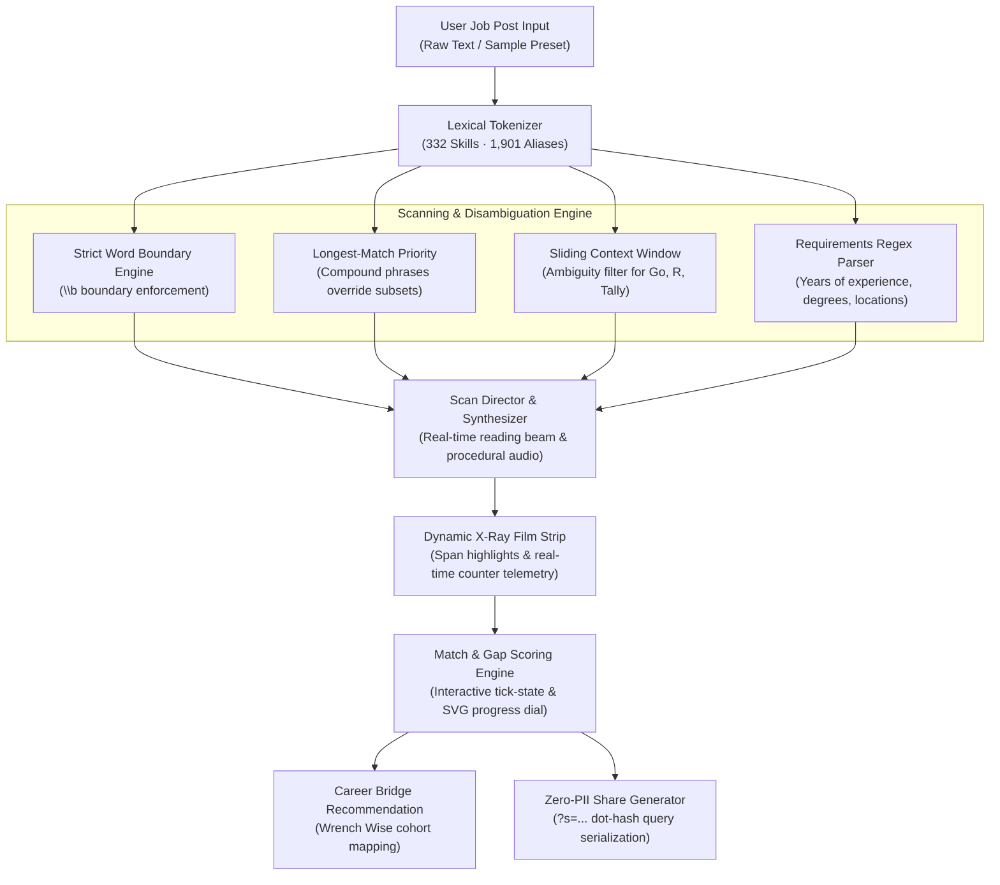

# Find the Skills (Job Post X-Ray) — Algorithmic ATS Scanner & Career Gap Engine

> **Live Application:** [find-the-skills.vercel.app](https://find-the-skills.vercel.app/)  
> **Interactive Automated Demo:** [find-the-skills.vercel.app/?demo=1&sample=s1](https://find-the-skills.vercel.app/?demo=1&sample=s1)  
> **In-Browser Test Suite:** [find-the-skills.vercel.app/?test=1](https://find-the-skills.vercel.app/?test=1)  
> **Author:** [B Pradeep](https://github.com/Pradeep-B28) · [Portfolio](https://pradeep-b28.github.io/Pradeep-B28/)

---

## Overview

**Find the Skills (Job Post X-Ray)** is an interactive client-side ATS (Applicant Tracking System) lexical keyword scanner and career qualification engine. It empowers job seekers and engineers to paste raw job descriptions and instantly view an animated X-ray scan beam that tokenizes, parses, and classifies technical skills, soft skills, and institutional requirements (experience tenure, degree levels, locations, and certifications).

Users interactively tick the skills they currently have to compute an immediate match score, perform gap analysis against target industry roles, and discover bridge learning pathways to close qualification gaps.

Engineered with pure Vanilla JavaScript (ES modules), native HTML5 Canvas, modern CSS variables, and procedural Web Audio API—zero runtime dependencies, zero telemetry, and zero build tool overhead.



---

## Technical Specifications & Architecture

| Parameter | Specification |
| :--- | :--- |
| **Lexical Skill Index** | 332 active skills (157 tech, 145 domain/job, 30 soft) organized across 21 structured groups |
| **Alias Resolution Rules** | 1,901 verified aliases with deterministic longest-token precedence (e.g., `React Native` precedes `React`) |
| **Ambiguity Disambiguation** | Character-distance sliding context window resolving short monosyllabic tokens (`Go`, `R`, `Tally`) |
| **Requirement Regex Engine** | Automated extraction of numeric tenure (`3-5 years`, `5+ yrs`), degree tiers (`B.Tech`, `M.S.`), and locations |
| **Procedural Audio Engine** | Native browser `AudioContext` synthesizing scan ticks, sweep chirps, and completion bells without sound assets |
| **3D Responsive Film Hero** | Contained 3D micro-tilt with clean level resting state, `requestAnimationFrame` pointer tracking, and smooth cubic-bezier return |
| **Zero-Server Privacy** | 100% client-side text processing; compare links encode only skill IDs (`?s=...`), never transmitting job text |
| **Automated Verification** | 108 exhaustive test assertions in `js/selftest.js`, 11 full sample posts, and 147 tricky validation sentences |
| **Performance** | Sub-10ms lexical scan on 15,000-character job postings; smooth 60 FPS hardware-accelerated beam animation |

---

## Lexical Matching & Rule Benchmarks

Standard substring searches and naive regular expressions routinely produce catastrophic false positives on technical resumes and job postings. Find the Skills implements a 4-tier filtering hierarchy:

| Input Text Pattern | Naive Substring Search | Find the Skills Engine | Resolution Mechanism |
| :--- | :--- | :--- | :--- |
| `"Looking for a good engineer"` | Matches **Go** (inside `good`) | **No Match** (Clean) | `\b` word boundary enforcement prevents intra-word token extraction |
| `"Django REST framework"` | Matches **Go** (inside `Django`) | **No Match** (Clean) | Strict token prefix/suffix validation |
| `"Experience with R&D operations"` | Matches **R** (Programming language) | **No Match** (Clean) | Sliding context window checks for data science terms (`statistics`, `dataframe`, `ggplot`) |
| `"React Native and React developers"` | Duplicate ambiguous matches | **Matches both distinctly** | Longest-match tokens take precedence during span allocation |
| `"Minimum 3 to 5 years experience"` | Raw unparsed string | **Extracted: Min 3, Max 5 Yrs** | Numeric regex parser structures experience thresholds for gap analysis |

---

## Core Capabilities

1. **Interactive X-Ray Scan Beam:**
   - Real-time reading beam travels down the job description at human scanning cadence.
   - Synchronized procedural Web Audio sound synthesis produces audio feedback as technical and soft skills light up.
   - Distinct color-coded film highlights differentiate between hard technical competencies, soft skills, and baseline requirements.

2. **3D Interactive Film Preview Tile:**
   - Contained 3D micro-tilt reacting smoothly to cursor hovering via `requestAnimationFrame`.
   - Engineered with a level resting orientation (`rotateX(0deg) rotateY(0deg)`) and smooth `cubic-bezier(0.16, 1, 0.3, 1)` return transitions.
   - Automatically disabled on touch screens and when `prefers-reduced-motion` is active.

3. **Instant Skill Gap & Role Classifier:**
   - Classifies posts across 25 industry roles (13 tech, 12 non-tech).
   - Dynamic tick interface lets candidates mark skills they know, calculating live match percentages with an animated SVG gauge.
   - Identifies high-leverage "bridge skills" required to pivot into the role.

4. **Zero-PII Social Sharing & Comparison:**
   - Generates canvas-rendered share graphics for WhatsApp status (9:16) and social feeds (4:5).
   - Generates URL compare links encoding matched skill IDs in compact dot notation (`?s=py.sql.docker&r=fsd&m=2`)—guaranteeing complete privacy with zero server storage.

---

## Automated Verification Test Suite

The engine is verified through terminal test harnesses and in-browser self-tests:

### 1. Terminal Content & Grammar Verifier
Validates all 332 skills, 1,901 aliases, 4 compound skills, 25 roles, and 147 tricky edge cases:
```bash
node tools/verify-content.mjs
```

### 2. Algorithmic Unit Tests
Executes all 108 assertions covering lexical rules, requirement parsing, scoring tiers, and privacy payloads:
```bash
node js/selftest.js
```

### 3. In-Browser Automated Test Runner
Open the application in any modern browser with the `?test=1` query flag:
```
https://find-the-skills.vercel.app/?test=1
```

---

## Special URL Parameters

- `?test=1`: Runs the automated test runner in the browser displaying pass/fail assertions.
- `?demo=1&sample=s1`: Launches automated hands-free demo mode scanning sample `s1` with automated ticks.
- `?present=1`: Enables high-contrast presenter mode with enlarged typography and keyboard shortcuts (`1`–`8`, `Enter`, `H`, `T`).
- `?s=id.id...&r=roleId&m=count`: Opens head-to-head comparison mode from a shared link.

---

## Local Development Setup

No build step, bundler, or package manager installation is required.

1. **Clone the repository:**
   ```bash
   git clone https://github.com/Pradeep-B28/Find_the_Skills.git
   cd Find_the_Skills
   ```

2. **Serve with any static HTTP server:**
   ```bash
   # Using Python 3
   python -m http.server 8000

   # Or using Node npx
   npx serve .
   ```

3. **Open in browser:**
   ```
   http://localhost:8000
   ```

---

## License

MIT © [B Pradeep](https://github.com/Pradeep-B28)
